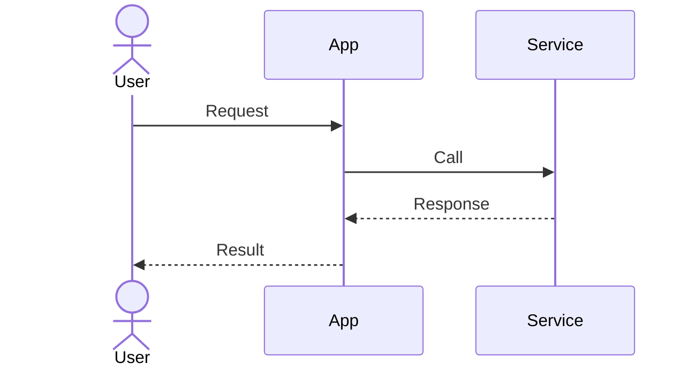

# SDD — [System/Feature Name]

- Status, owner, date, linked PRD:

## Context, Goals, and Constraints

## Architecture and System Boundaries

## Modules and Responsibilities

## Data Model and Migration

## API / Event Contracts

## Key Flows

## Security, Privacy, and Failure Modes

## Observability, Performance, and Accessibility

## Testing and Deployment

## Options, Trade-offs, and Related ADRs
