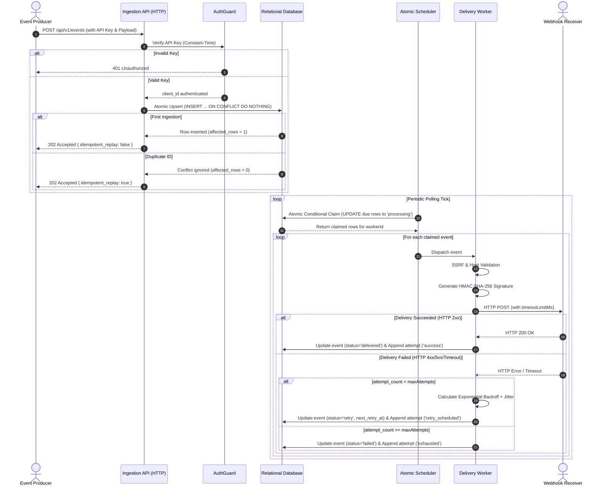

# SDD — Webhook Delivery Engine

| Field          | Value                                                            |
| :------------- | :--------------------------------------------------------------- |
| **Status**     | Approved — Ready for Implementation                              |
| **Owner**      | Hamid Javadi (Product Engineer) & Tech Lead (Node.js/TypeScript) |
| **Date**       | 2026-10-16                                                       |
| **Linked PRD** | [PRD.md](./PRD.md) (v1.0.0)                                      |
| **Template**   | `templates/SDD-template.md` (agents.zip)                         |

---

## 1. Context, Goals, and Constraints

### 1.1 Context and Problem Overview

External webhook delivery is prone to silent event loss and duplicate deliveries due to transient network failures, target downtime (HTTP 5xx), timeouts, and application restarts. The existing solution lacks an embedded, lightweight, and durable retry engine. The Webhook Delivery Engine is an embeddable Node.js library and standalone HTTP service designed to provide guaranteed at-least-once delivery, idempotent ingestion, deterministic exponential backoff with full jitter, and complete per-attempt observability.

### 1.2 In-Scope Goals

- **Durable Persistence & Recovery:** Enqueue events into durable relational storage (SQLite, PostgreSQL, MySQL) so that no accepted event is lost across process restarts.
- **Idempotent Ingestion:** Deduplicate incoming events using unique client-provided IDs via atomic single-statement upsert.
- **Unified Atomic Claiming:** Safely acquire batches of due events across concurrent workers and different database engines without double-delivery under normal operation.
- **Cryptographic Security:** Guard ingestion using constant-time API key verification, prevent outbound Server-Side Request Forgery (SSRF), and sign outbound webhooks using HMAC SHA-256 with timestamp headers.
- **Execution & Observability:** Execute HTTP dispatches with configurable per-attempt timeouts, log execution transitions in structured JSON, and append comprehensive audit records for every attempt.

### 1.3 Non-Goals (Out of Scope for v1)

- Exactly-once delivery semantics (engine guarantees at-least-once; downstream receivers must be idempotent).
- Distributed message brokers (Kafka, RabbitMQ, Redis).
- Tenant-specific retry policies (v1 enforces global configuration for timeouts and maximum attempts).
- Manual dead-letter queue re-drive UI and real-time Prometheus/OpenTelemetry metric exporters.
- Outbound network protocols other than HTTP/HTTPS (e.g., gRPC, AMQP, WebSocket). Note: HTTPS is strictly enforced in production; plain HTTP is restricted to local/test environments only.

### 1.4 Technical and Operational Constraints

- **Runtime:** Node.js `>= 24.x` with TypeScript strict mode enabled (`noImplicitAny: true`, `strictNullChecks: true`).
- **Database Support:** Pluggable engine support for SQLite (`better-sqlite3`), PostgreSQL (`pg`), and MySQL (`mysql2`).
- **Packaging:** Dual-mode operation: embeddable TypeScript/JavaScript package (`npm` / `pnpm`) and standalone microservice container (`Dockerfile`).
- **Concurrency & Semantics:** Single-writer constraints in SQLite handled gracefully via `WAL` mode and immediate transactions; relational row leases managed without distributed locking.

---

## 2. Architecture and System Boundaries

The system architecture cleanly separates external ingress, database abstraction, scheduling loops, and secure outbound dispatchers.

### 2.1 ASCII Architectural Diagram

```
+-----------------------------------------------------------------------------------+
|                               EXTERNAL BOUNDARY                                   |
|                                                                                   |
|   +-----------------------+                         +-------------------------+   |
|   |   Ingestion Client    |                         |    Webhook Receiver     |   |
|   |  (API Key Header)     |                         | (Verifies HMAC SHA-256) |   |
|   +-----------+-----------+                         +------------^------------+   |
+---------------|--------------------------------------------------|----------------+
                | POST /api/v1/events                              | HTTP POST + HMAC
                v                                                  |
+------------------------------------------------------------------|----------------+
| WEBHOOK DELIVERY ENGINE                                          |                |
|                                                                  |                |
|  +--------------------------+                                    |                |
|  |     HTTP REST Server     |                                    |                |
|  | (Fastify / Node Native)  |                                    |                |
|  | - Auth Guard (TimingSafe)|                                    |                |
|  | - Payload & URL Validator|                                    |                |
|  +------------+-------------+                                    |                |
|               |                                                  |                |
|               v                                                  |                |
|  +--------------------------+         +--------------------------+-------------+  |
|  |   Event Ingestion Core   |         |            Dispatch Worker             |  |
|  | - Idempotency Resolver   |         | - URL SSRF Inspector & DNS Resolver    |  |
|  | - Event Persister        |         | - HMAC Request Signer (SHA-256)        |  |
|  +------------+-------------+         | - HTTP Dispatcher (AbortSignal Timeout)|  |
|               |                       +--------------------------^-------------+  |
|               |                                                  |                |
|               | Insert Pending Event                             | Due Batch      |
|               v                                                  |                |
|  +---------------------------------------------------------------+-------------+  |
|  |                       Atomic Scheduler & Poller                             |  |
|  | - Bounded Polling Loop (Timer + Jitter)                                     |  |
|  | - Atomic Lease Acquirer (Conditional UPDATE ... WHERE status IN ('pending'))|  |
|  | - Exponential Backoff Calculator (Full Jitter, Max Attempts Threshold)      |  |
|  +------------------------------------+----------------------------------------+  |
|                                       |                                           |
|                                       v                                           |
|  +-----------------------------------------------------------------------------+  |
|  |                     Database Engine Abstraction (DAL)                       |  |
|  |  [ DatabaseAdapter Interface: query, execute, transaction, atomicClaim ]   |  |
|  +-----------------+-------------------+-------------------+-------------------+  |
|                    |                   |                   |                      |
+--------------------|-------------------|-------------------|----------------------+
                     v                   v                   v
              +--------------+    +---------------+    +---------------+
              | SQLite (WAL) |    |  PostgreSQL   |    |     MySQL     |
              | better-sqlite3    |  pg Driver    |    |  mysql2 Driver|
              +--------------+    +---------------+    +---------------+
```

---

## 3. Modules and Responsibilities

| Module                   | Responsibilities                                                                                                                         | Dependencies                             | Invariants                                                                                                                                                       |
| :----------------------- | :--------------------------------------------------------------------------------------------------------------------------------------- | :--------------------------------------- | :--------------------------------------------------------------------------------------------------------------------------------------------------------------- |
| **HttpServer & Routing** | Exposes REST endpoints (`/api/v1/events`, query APIs, health); parses payloads; coordinates response serialisation.                      | Fastify / Native HTTP, `AuthGuard`       | Rejects requests exceeding 1 MB; returns HTTP 202 for accepted ingestion.                                                                                        |
| **AuthGuard**            | Enforces constant-time API key verification; maps keys to authenticated `client_id`s; guards internal routes.                            | Node `crypto` (`timingSafeEqual`)        | No string equality operator used on secrets; comparison latency invariant to secret content.                                                                     |
| **IngestionManager**     | Coordinates event ingestion; ensures payload schema validation; performs atomic upsert into `webhook_events`.                            | `DatabaseAdapter`, `ValidationSchema`    | Event ID serves as the global idempotency key; duplicate submission of an existing ID short-circuits ingestion and safely returns `{ idempotent_replay: true }`. |
| **AtomicScheduler**      | Runs periodic tick to find due events; claims batches atomically via database conditional updates; handles orphaned claim recovery.      | `DatabaseAdapter`, `ConfigManager`       | No event claimed by multiple workers simultaneously; poll loop CPU overhead < 10% when idle.                                                                     |
| **DeliveryWorker**       | Dispatches HTTP requests; computes HMAC SHA-256 signatures; enforces per-request timeout abort signals; logs execution.                  | `HttpSigner`, `SsrfFilter`, Node `fetch` | Never transmits to forbidden IP ranges; strictly terminates requests after `timeoutLimitMs`.                                                                     |
| **HttpSigner**           | Generates deterministic HMAC SHA-256 signatures over timestamp and payload; attaches signature headers.                                  | Node `crypto` (`createHmac`)             | Signature material format: `${timestamp}.${payload}`; timestamp matches request dispatch.                                                                        |
| **SsrfFilter**           | Performs pre-flight URL inspection; resolves DNS hostnames; blocks loopback, private RFC 1918, link-local, and cloud metadata addresses. | Node `dns/promises`, Node `net`          | Unsafe destination hosts rejected before establishing TCP/TLS connection.                                                                                        |
| **BackoffEngine**        | Calculates retry timestamps using bounded exponential backoff with full randomized jitter; evaluates terminal exhaustion.                | Config parameters                        | `delay = random(0, min(base * 2^(attempt - 1), capMs))`; retries cease at `maxAttempts`.                                                                         |
| **DatabaseAdapter**      | Abstracts dialect-specific queries, connections, migrations, and atomic conditional update statements.                                   | `better-sqlite3`, `pg`, `mysql2`         | All SQL executed via parameterized statements; zero SQL string interpolation.                                                                                    |

---

## 4. Data Model and Migration

### 4.1 Table: `webhook_events`

Stores master event records and acts as the idempotency anchor.

| Column Name       | Data Type (SQLite / Postgres / MySQL)         | Constraints                   | Description                                                                                                                                                                                                                                                         |
| :---------------- | :-------------------------------------------- | :---------------------------- | :------------------------------------------------------------------------------------------------------------------------------------------------------------------------------------------------------------------------------------------------------------------ |
| `id`              | `VARCHAR(64)` / `VARCHAR(64)` / `VARCHAR(64)` | PRIMARY KEY, NOT NULL         | Primary event identifier, acting as client-supplied idempotency key (deduplication anchor per tenant).                                                                                                                                                              |
| `client_id`       | `VARCHAR(64)` / `VARCHAR(64)` / `VARCHAR(64)` | NOT NULL                      | Tenant / caller identity extracted from API key.                                                                                                                                                                                                                    |
| `destination_url` | `TEXT` / `TEXT` / `TEXT`                      | NOT NULL                      | Validated HTTPS/HTTP target endpoint URL.                                                                                                                                                                                                                           |
| `payload`         | `TEXT` / `TEXT` / `TEXT`                      | NOT NULL                      | Raw event payload (JSON string).                                                                                                                                                                                                                                    |
| `status`          | `VARCHAR(20)` / `VARCHAR(20)` / `VARCHAR(20)` | NOT NULL, DEFAULT `'pending'` | Lifecycle state: `'pending'` (newly ingested, never attempted), `'processing'` (actively leased by a worker), `'retry'` (failed an attempt and scheduled for backoff retry), `'delivered'` (terminal success), `'failed'` (terminal exhaustion after max attempts). |
| `attempt_count`   | `INTEGER` / `INTEGER` / `INT`                 | NOT NULL, DEFAULT `0`         | Number of outbound delivery attempts executed.                                                                                                                                                                                                                      |
| `next_retry_at`   | `INTEGER` (epoch ms) / `BIGINT` / `BIGINT`    | NULLABLE                      | Epoch timestamp in milliseconds for next scheduled run.                                                                                                                                                                                                             |
| `locked_at`       | `INTEGER` (epoch ms) / `BIGINT` / `BIGINT`    | NULLABLE                      | Timestamp when worker lease was granted.                                                                                                                                                                                                                            |
| `locked_by`       | `VARCHAR(64)` / `VARCHAR(64)` / `VARCHAR(64)` | NULLABLE                      | Unique worker identifier holding current lease.                                                                                                                                                                                                                     |
| `created_at`      | `INTEGER` (epoch ms) / `BIGINT` / `BIGINT`    | NOT NULL                      | Event ingestion timestamp.                                                                                                                                                                                                                                          |
| `updated_at`      | `INTEGER` (epoch ms) / `BIGINT` / `BIGINT`    | NOT NULL                      | Record last modification timestamp.                                                                                                                                                                                                                                 |

**Indexes:**

- `idx_webhook_events_due`: `(status, next_retry_at)` — Claim worker index filtering eligible records.
- `idx_webhook_events_stale`: `(status, locked_at)` — Orphaned lease recovery index.
- `idx_webhook_events_client`: `(client_id, created_at)` — Multi-tenant lookup and reporting index.

### 4.2 Table: `webhook_event_attempts`

Append-only immutable audit trail recording every delivery dispatch.

| Column Name        | Data Type (SQLite / Postgres / MySQL)                                                               | Constraints                                           | Description                                                      |
| :----------------- | :-------------------------------------------------------------------------------------------------- | :---------------------------------------------------- | :--------------------------------------------------------------- |
| `id`               | `INTEGER PRIMARY KEY AUTOINCREMENT` / `BIGSERIAL PRIMARY KEY` / `BIGINT AUTO_INCREMENT PRIMARY KEY` | PRIMARY KEY, NOT NULL                                 | Unique sequential audit identifier.                              |
| `event_id`         | `VARCHAR(64)` / `VARCHAR(64)` / `VARCHAR(64)`                                                       | NOT NULL, FK → `webhook_events(id)` ON DELETE CASCADE | Reference to parent event.                                       |
| `attempt_number`   | `INTEGER` / `INTEGER` / `INT`                                                                       | NOT NULL                                              | 1-based attempt ordinal.                                         |
| `attempted_at`     | `INTEGER` (epoch ms) / `BIGINT` / `BIGINT`                                                          | NOT NULL                                              | Timestamp when outbound HTTP dispatch started.                   |
| `status_code`      | `INTEGER` / `INTEGER` / `INT`                                                                       | NULLABLE                                              | HTTP status code received (null on network timeout/drop).        |
| `response_snippet` | `VARCHAR(1024)` / `VARCHAR(1024)` / `VARCHAR(1024)`                                                 | NULLABLE                                              | Truncated response body (bounded at <= 1024 bytes).              |
| `error`            | `TEXT` / `TEXT` / `TEXT`                                                                            | NULLABLE                                              | Error message, DNS failure, or abort timeout description.        |
| `latency_ms`       | `INTEGER` / `INTEGER` / `INT`                                                                       | NULLABLE                                              | HTTP round-trip dispatch latency in milliseconds.                |
| `outcome`          | `VARCHAR(20)` / `VARCHAR(20)` / `VARCHAR(20)`                                                       | NOT NULL                                              | Attempt result: `'success'`, `'retry_scheduled'`, `'exhausted'`. |

**Indexes:**

- `idx_attempts_event`: `(event_id, attempt_number)` — Fast attempt history resolution per event.

### 4.3 Migration Strategy Across Dialects

A lightweight, transactional schema runner executes versioned raw SQL scripts against the active database:

- **SQLite:** WAL mode (`PRAGMA journal_mode = WAL;`) and busy timeout (`PRAGMA busy_timeout = 5000;`) enabled at connection initialization. Foreign keys enforced via `PRAGMA foreign_keys = ON;`.
- **PostgreSQL:** Executed inside explicit transactions (`BEGIN; ... COMMIT;`). Uses standard `BIGINT` epoch timestamps to maintain integer arithmetic consistency across all drivers.
- **MySQL:** Tables declared with `ENGINE=InnoDB DEFAULT CHARSET=utf8mb4 COLLATE=utf8mb4_unicode_ci`. Foreign keys reference indexed columns.

---

## 5. API / Event Contracts

### 5.1 Ingestion API

**Endpoint:** `POST /api/v1/events`  
**Headers:**

- `Authorization: Bearer <API_KEY>`
- `Content-Type: application/json`

**Request Payload:**

```json
{
  "id": "evt_01JAZ683C72A99BXN4",
  "destination_url": "https://consumer.example.com/webhooks",
  "payload": { "event": "order.created", "amount": 4500 }
}
```

**Responses:**

- `202 Accepted` (New event ingested):
  ```json
  {
    "status": "accepted",
    "id": "evt_01JAZ683C72A99BXN4",
    "idempotent_replay": false,
    "created_at": 1729000000000
  }
  ```
- `202 Accepted` (Duplicate ID submitted — Idempotent Replay):
  ```json
  {
    "status": "accepted",
    "id": "evt_01JAZ683C72A99BXN4",
    "idempotent_replay": true,
    "created_at": 1729000000000
  }
  ```
- `400 Bad Request` (Invalid URL, SSRF rejection, or schema validation error):
  ```json
  {
    "error": "BAD_REQUEST",
    "message": "destination_url resolves to disallowed private network address"
  }
  ```
- `401 Unauthorized` (Missing or invalid API key):
  ```json
  {
    "error": "UNAUTHORIZED",
    "message": "Invalid or missing API key"
  }
  ```

### 5.2 Status and History Query Endpoints

- `GET /api/v1/events/:id`  
  Returns master record status, current retry count, next retry timestamp, and summary metadata.
- `GET /api/v1/events?status=<status>&limit=<limit>&offset=<offset>`  
  Lists events filtered by `status` with pagination via `limit` (page size, default 50) and `offset` (zero-based).
- `GET /api/v1/events/:id/attempts`  
  Returns full audit trail list of all attempts from `webhook_event_attempts` ordered by `attempt_number ASC`.

### 5.3 Outbound HMAC SHA-256 Delivery Signature Specification

Every HTTP POST dispatch sends the raw payload accompanied by cryptographic verification headers:

- `x-webhook-signature`: `sha256=<hex_digest>`
- `x-webhook-timestamp`: `<epoch_seconds>`
- `x-webhook-id`: `<event_id>`

**Signing Algorithm:**

1. Generate current epoch timestamp in seconds: `ts = Math.floor(Date.now() / 1000).toString()`.
2. Construct signature material string: `signed_payload = "${ts}.${raw_body}"`.
3. Compute HMAC SHA-256: `digest = crypto.createHmac('sha256', HMAC_SECRET).update(signed_payload).digest('hex')`.
4. Transmit header: `x-webhook-signature: sha256=${digest}` and `x-webhook-timestamp: ${ts}`.

---

## 6. Key Flows

### 6.1 End-to-End Ingestion and Delivery Lifecycle



### 6.2 Atomic Conditional Claim Pattern Across Dialects

To eliminate race conditions and avoid heavy external locks, the engine utilizes an atomic conditional update lease pattern. A worker updates eligible rows and sets `locked_by` to its unique worker ID (`worker_uuid`).

**Eligibility Predicate:**

```sql
(status IN ('pending', 'retry') AND (next_retry_at IS NULL OR next_retry_at <= :now))
OR
(status = 'processing' AND locked_at <= :stale_cutoff)
```

**Dialect Implementations:**

1. **PostgreSQL:**
   ```sql
   UPDATE webhook_events
   SET status = 'processing',
       locked_at = :now,
       locked_by = :worker_id,
       updated_at = :now
   WHERE id IN (
     SELECT id FROM webhook_events
     WHERE (status IN ('pending', 'retry') AND (next_retry_at IS NULL OR next_retry_at <= :now))
        OR (status = 'processing' AND locked_at <= :stale_cutoff)
     ORDER BY next_retry_at ASC NULLS FIRST
     LIMIT :batch_size
     FOR UPDATE SKIP LOCKED
   )
   RETURNING *;
   ```
2. **SQLite:**
   Executed inside an immediate transaction (`BEGIN IMMEDIATE`):
   ```sql
   UPDATE webhook_events
   SET status = 'processing',
       locked_at = :now,
       locked_by = :worker_id,
       updated_at = :now
   WHERE id IN (
     SELECT id FROM webhook_events
     WHERE (status IN ('pending', 'retry') AND (next_retry_at IS NULL OR next_retry_at <= :now))
        OR (status = 'processing' AND locked_at <= :stale_cutoff)
     ORDER BY CASE WHEN next_retry_at IS NULL THEN 0 ELSE 1 END, next_retry_at ASC
     LIMIT :batch_size
   );
   -- Followed immediately by:
   SELECT * FROM webhook_events WHERE locked_by = :worker_id AND status = 'processing';
   ```
3. **MySQL (8.0+):**
   ```sql
   UPDATE webhook_events
   SET status = 'processing',
       locked_at = :now,
       locked_by = :worker_id,
       updated_at = :now
   WHERE id IN (
     SELECT id FROM (
       SELECT id FROM webhook_events
       WHERE (status IN ('pending', 'retry') AND (next_retry_at IS NULL OR next_retry_at <= :now))
          OR (status = 'processing' AND locked_at <= :stale_cutoff)
       ORDER BY next_retry_at ASC
       LIMIT :batch_size
       FOR UPDATE SKIP LOCKED
     ) AS t
   );
   -- Followed by reading assigned rows:
   SELECT * FROM webhook_events WHERE locked_by = :worker_id AND locked_at = :now;
   ```

---

## 7. Security, Privacy, and Failure Modes

### 7.1 Constant-Time API Key Authentication

All protected ingress routes validate client credentials against configured keys. To defend against side-channel timing attacks:

1. The incoming key and expected key are hashed using SHA-256 to ensure identical buffer lengths:
   `hashA = crypto.createHash('sha256').update(incomingKey).digest()`
   `hashB = crypto.createHash('sha256').update(expectedKey).digest()`
2. Comparison is performed strictly via `crypto.timingSafeEqual(hashA, hashB)`.
3. Early string equality checks (`===`) are explicitly prohibited.

### 7.2 Outbound SSRF Mitigation Policy

Before opening a network connection to `destination_url`:

1. Parse URL protocol; enforce strict `https:` in production environments (`http:` is rejected by default and only permitted when explicitly enabled via `ALLOW_INSECURE_HTTP=true` in local/test configurations).
2. Perform DNS lookup via `dns.promises.lookup(host, { all: true })`.
3. Validate all resolved IP addresses against blacklisted CIDR blocks:
   - Loopback: `127.0.0.0/8`, `::1`
   - RFC 1918 Private ranges: `10.0.0.0/8`, `172.16.0.0/12`, `192.168.0.0/16`
   - Link-local: `169.254.0.0/16`, `fe80::/10`
   - Cloud Metadata Services: `169.254.169.254`, `metadata.google.internal`
4. If an address resolves to a restricted block, the delivery immediately aborts with error code `ERR_SSRF_BLOCKED`, recording the attempt as a failure without transmitting any bytes.

### 7.3 Detailed Failure Modes & Recovery Matrix

| Failure Mode                             | Direct Impact                                                 | Detection Mechanism                                                                   | Automated Mitigation / Recovery                                                                                 |
| :--------------------------------------- | :------------------------------------------------------------ | :------------------------------------------------------------------------------------ | :-------------------------------------------------------------------------------------------------------------- |
| **Worker Crash mid-dispatch**            | Event row left stranded in `status = 'processing'`.           | Scheduler detects `status = 'processing'` where `locked_at < (now - STALE_LEASE_MS)`. | Stale-lease reclamation query automatically resets lock and reverts event to `'retry'` status.                  |
| **Target Webhook Slow / Hanging**        | Dispatch worker thread blocked waiting for response socket.   | `AbortSignal.timeout(timeoutLimitMs)` triggers abort signal.                          | HTTP client tears down connection, records `error = 'ETIMEDOUT'`, and records attempt with duration.            |
| **Database Disconnect (Transient)**      | Scheduler loop or ingestion endpoint cannot persist state.    | DB connection pool emits connection error event / query throws.                       | Circuit breaker pauses scheduler loop with backoff; returns 503 on ingestion without crashing host.             |
| **SQLite Busy (`SQLITE_BUSY`)**          | Concurrency contention between write transaction and pollers. | `SqliteError: database is locked` caught by adapter.                                  | Configured `busy_timeout = 5000ms`, `WAL` mode active, and exponential backoff retry on write lock acquisition. |
| **Receiver 5xx / 429 Throttle**          | Downstream receiver temporarily overloaded or failing.        | HTTP status returned in range 500–599 or 429.                                         | Event marked for retry; backoff engine adds randomized exponential jitter to prevent thundering herd.           |
| **Receiver Permanent Failure (404/410)** | Target webhook URL decommissioned or non-existent.            | HTTP status returned 404 or 410.                                                      | Evaluated against retry policy; retried up to `maxAttempts` before being safely recorded as `exhausted`.        |

---

## 8. Observability, Performance, and Accessibility

### 8.1 JSON Structured Logging Format

All system events, audit records, and operational errors output machine-readable single-line JSON logs to `stdout`/`stderr` adhering to the following schema:

```json
{
  "timestamp": "2026-10-16T12:00:00.123Z",
  "level": "INFO",
  "service": "webhook-delivery-engine",
  "event": "delivery_attempt_completed",
  "eventId": "evt_01JAZ683C72A99BXN4",
  "clientId": "client_default_tenant",
  "attemptNumber": 2,
  "statusCode": 503,
  "latencyMs": 245,
  "outcome": "retry_scheduled",
  "nextRetryAt": 1729000004500,
  "workerId": "worker-node-1-pid-4512"
}
```

_Sanitization Rule:_ Sensitive headers (`Authorization`, `x-api-key`), HMAC keys, and full unescaped request payloads are automatically stripped from log outputs.

### 8.2 Performance Targets and Service Levels

- **Ingestion Latency (p95):** `< 50 ms` for local SQLite instances, `< 75 ms` for networked PostgreSQL/MySQL instances under nominal load.
- **Ingestion Sustained Throughput:** `≥ 200 events/second` sustained on SQLite in WAL mode.
- **Scheduler Idle Overhead:** `< 10% CPU` utilization during empty poll ticks.
- **Batch Processing Throughput:** Scalable batch claims of 10–50 events per cycle with round-trip lease resolution `< 30 ms`.

### 8.3 Accessibility

As a backend headless service / developer library without a graphical user interface, direct WCAG accessibility requirements are **Not Applicable (N/A)**. Error messages and log outputs follow structured UTF-8 text standards.

## 9. Testing and Deployment

### 9.1 Vitest Test Matrix

The test suite enforces rigorous verification using Vitest across four dedicated testing quadrants:

| Category                 | Scope & Objective                                                                                                 | Environment / Drivers                                  | Target Gate                                   |
| :----------------------- | :---------------------------------------------------------------------------------------------------------------- | :----------------------------------------------------- | :-------------------------------------------- |
| **Unit Tests**           | Backoff math (full jitter distributions), HMAC signing calculation, SSRF CIDR filters, constant-time comparisons. | In-memory mock timers, Node native crypto              | 100% logic coverage, 0 ms network delay       |
| **Integration Tests**    | Ingestion REST API, duplicate idempotency checks, lease transitions (`pending -> processing -> delivered/retry`). | Ephemeral SQLite, Testcontainers PostgreSQL / MySQL    | Complete lifecycle verification               |
| **Multi-DB Concurrency** | Race condition tests: 10 parallel worker threads attempting to claim identical pools of 100 due events.           | SQLite (`WAL`), PostgreSQL, MySQL                      | Exactly 0 double-claims; all events processed |
| **Fault Injection**      | Aborted connections, forced process termination mid-claim, synthetic 10-second target latency timeouts.           | Mock HTTP servers with intentional delays and failures | 100% orphaned claim recovery verification     |

### 9.2 Packaging and Deployment Strategy

- **NPM / Library Packaging:** Compiled to clean ECMAScript Modules (ESM) and CommonJS (CJS) with bundled TypeScript declarations (`dist/index.d.ts`). Exposes `createWebhookEngine()`, database adapters, and Fastify plugin bindings.
- **Standalone Container Packaging:** Multi-stage distroless `Dockerfile`:
  1. _Builder Stage:_ Node 24 Alpine, installs dependencies via `pnpm`, builds TypeScript source.
  2. _Runner Stage:_ Node 24 distroless/minimal image, runs unprivileged non-root user (`USER node`), exposes port `3000`.
- **Zero-Downtime Migration:** Schema migrations are strictly backward-compatible. Additive columns and indexes run safely on live databases prior to deploying updated application binaries.

---

## 10. Options, Trade-offs, and Related ADRs

### 10.1 Architectural Decision Options & Trade-offs

| Decision Area               | Options Considered                                                                      | Selected Architecture                              | Trade-off Rationale                                                                                                               |
| :-------------------------- | :-------------------------------------------------------------------------------------- | :------------------------------------------------- | :-------------------------------------------------------------------------------------------------------------------------------- |
| **Persistence Engine**      | A. In-Memory Queue<br>B. Redis / BullMQ<br>C. Embedded/Relational SQL                   | **Option C: Relational SQL (SQLite/PG/MySQL)**     | Eliminates external infrastructure dependencies for embedded library users while retaining enterprise concurrency and durability. |
| **Atomic Claim Mechanism**  | A. Distributed Redis Lock<br>B. DB Row Conditional UPDATE<br>C. Database Advisory Locks | **Option B: DB Row Conditional UPDATE with Lease** | Uniform across SQLite, Postgres, and MySQL. Works seamlessly without database-specific proprietary locking features.              |
| **Ingestion Deduplication** | A. Read-then-Write (SELECT -> INSERT)<br>B. Unique Constraint with Upsert               | **Option B: Single-Statement Upsert**              | Eliminates race condition windows during high-frequency ingestion; guarantees idempotency at the storage engine level.            |
| **Worker Architecture**     | A. Multi-process clustering<br>B. Single-process async poll & dispatch                  | **Option B: Async Poller with Bounded Batching**   | Minimizes CPU overhead and simplifies lifecycle management in embedded library contexts.                                          |

### 10.2 Related ADR References

- `docs/02-design/adr/ADR-001-unified-atomic-claim.md` — Rationale for conditional `UPDATE` lease pattern across SQL dialects.
- `docs/02-design/adr/ADR-002-ssrf-mitigation-strategy.md` — Architectural enforcement of pre-flight DNS and IP validation.
- `docs/02-design/adr/ADR-003-constant-time-auth.md` — Mitigation of side-channel timing attacks on API key verification.
