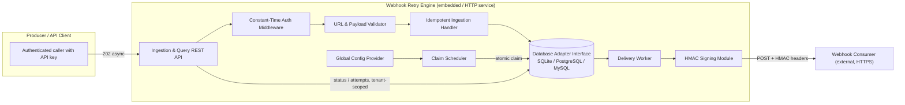
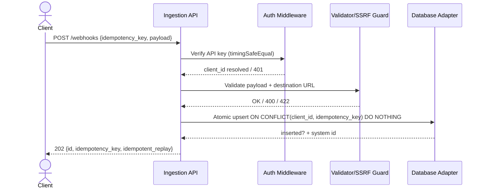
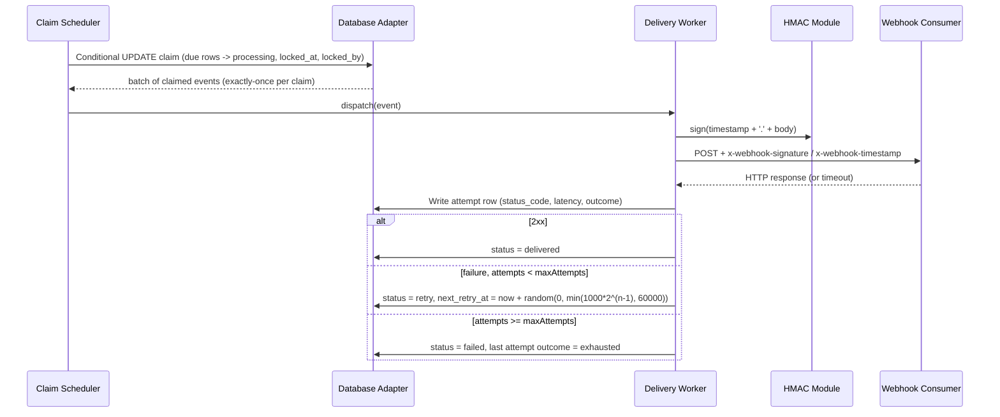

# SDD — Webhook Retry Engine

| Field            | Value                                                    |
| ---------------- | -------------------------------------------------------- |
| **Status**       | Draft (v1.0.0) — awaiting design-checkpoint approval     |
| **Owner**        | Product Engineer (Hamid Javadi)                          |
| **Date**         | 2026-10-15                                               |
| **Version**      | 1.0.0                                                    |
| **Template**     | `templates/SDD-template.md` (agents.zip)                 |
| **Linked PRD**   | `PRD.md` (v1.0.0, Approved/Baseline)                     |
| **Linked Scope** | `scope.md` (v1.0.0, Approved/Baseline)                   |
| **Linked WBS**   | `WBS.md` (v1.0.0, Approved / Ready for SDD)              |
| **Linked Risks** | `risks.md`                                               |
| **Related ADRs** | `docs/02-design/adr/` (to be filed at design checkpoint) |

---

## 1. Context, Goals, and Constraints

### 1.1 Context

The Webhook Retry Engine is a lightweight, embeddable Node.js (≥ 24.x) and TypeScript library and optional standalone HTTP service that delivers outgoing webhooks to external consumer endpoints with durable persistence, idempotent ingestion, bounded retries, and full attempt observability. Today, single-shot HTTP POSTs to the configured `WEBHOOK_URL` silently discard events on any transient failure (network error, HTTP 5xx, timeout, 429), re-deliver duplicates after restarts, and provide no audit trail. The engine closes these gaps without introducing external message brokers (no Redis, Kafka, or RabbitMQ — constraint C2).

### 1.2 Goals (traceable to PRD §4)

- **G1 — No silent loss:** every accepted event terminates in exactly one of `delivered`, `retry`, or `failed` with a complete recorded attempt history.
- **G2 — Idempotency:** duplicate ingestion of the same (`client_id`, `idempotency_key`) pair creates exactly one delivery job, including under ≥ 1000-subject concurrent submission.
- **G3/G4 — Reliability and concurrency safety:** bounded exponential backoff with full jitter; a single, driver-agnostic atomic claim pattern guarantees no concurrent double-claims on SQLite, PostgreSQL, and MySQL.
- **G5 — Security:** constant-time API-key authentication on ingestion; HMAC SHA-256 signed deliveries with timestamp; strict tenant isolation (BOLA/IDOR prevention); SSRF-safe destination validation.
- **G6/G7 — Performance and observability:** p95 ingestion latency < 50 ms (SQLite local); idle claim overhead < 10% CPU; ≥ 200 events/s sustained ingestion; per-attempt records for 100% of attempts.
- **G8 — Quality:** Vitest coverage ≥ 80% overall and ≥ 95% on critical paths (ingestion, atomic claim, retry scheduler, auth, HMAC).

### 1.3 Non-Goals (Out of Scope, per `scope.md` §3)

Per-tenant configuration and retry policies; admin UI/dashboard; Prometheus/OTel metrics export (structured JSON logs only); dead-letter re-drive/replay tooling; inter-event priority or ordering guarantees; multi-node scheduling coordination beyond the atomic claim guarantee; non-HTTP transports; signing schemes other than HMAC SHA-256; consumer-side verification SDK; alternative databases (MongoDB, Redis).

### 1.4 Constraints

| ID  | Constraint                        | Design Impact                                                                                                  |
| --- | --------------------------------- | -------------------------------------------------------------------------------------------------------------- |
| C1  | Node.js ≥ 24.x, TypeScript strict | Native `fetch`, `crypto.timingSafeEqual`, strict null checks throughout                                        |
| C2  | Zero heavy brokers                | Embedded SQL persistence + in-process scheduler; queue semantics implemented over relational rows              |
| C3  | Master-rule governance            | Schema/API/technology choices finalized only at the design checkpoint with user approval                       |
| C4  | At-least-once delivery            | Consumers deduplicate by system-generated event `id` (delivered in header and body); no exactly-once guarantee |

---

## 2. Architecture and System Boundaries

### 2.1 High-Level View



### 2.2 System Boundaries

- **Inside the boundary:** ingestion API, authentication middleware, validation, idempotent enqueue, claim scheduler, delivery worker, backoff computation, HMAC signing, attempt audit persistence, DB adapters, migration runner, structured logging.
- **Outside the boundary:** the producer's application (embeds or calls the engine), the external webhook consumer (verifies HMAC at its own discretion), database server administration, reverse proxies/TLS termination.
- **Deployment modes:** (a) embedded library import within a host Node.js process; (b) standalone HTTP service via `pnpm dev`. Both share identical internal modules; only the transport layer differs.

### 2.3 Data Flow Summary

Ingestion path (synchronous, fast): request → auth (constant-time) → validation (schema + SSRF URL check) → single-statement atomic upsert on `UNIQUE(client_id, idempotency_key)` → `202 Accepted` with `{ id, idempotency_key, idempotent_replay }`. Delivery path (asynchronous): scheduler polls due rows → atomic conditional `UPDATE` claim → worker dispatch with HMAC-signed request → attempt row written → status transition (`delivered` / `retry` with `next_retry_at` / `failed`).

---

## 3. Modules and Responsibilities

| Module                                 | Responsibility                                                                                                                                                                                                                                           | Key Dependencies                 |
| -------------------------------------- | -------------------------------------------------------------------------------------------------------------------------------------------------------------------------------------------------------------------------------------------------------- | -------------------------------- |
| **Domain Types** (WBS 1.2)             | `WebhookEvent`, `AttemptRecord`, `DatabaseAdapter`, `EngineConfig` contracts; the stable seam all modules program against.                                                                                                                               | None                             |
| **Persistence Adapters** (WBS 2.3–2.5) | One `DatabaseAdapter` implementation per dialect — `better-sqlite3` (WAL, `busy_timeout=5000`, `BEGIN IMMEDIATE`), `pg` (pooling, `ON CONFLICT DO NOTHING`), `mysql2` (pooling, `INSERT IGNORE`). All statements parameterized (NFR-S4).                 | Domain Types, Migration Runner   |
| **Migration Runner** (WBS 2.2)         | Idempotent, in-process DDL migrations across all three dialects; no external CLI. Version table records applied migrations.                                                                                                                              | Adapters                         |
| **Auth Middleware** (WBS 3.1)          | Bearer/`x-api-key` verification via `crypto.timingSafeEqual` over SHA-256 pre-hashed fixed-length buffers; no early exits; resolves `client_id` for tenant stamping.                                                                                     | Domain Types                     |
| **Validator / SSRF Guard** (WBS 3.2)   | Zod-style payload schema validation; URL resolution blocking loopback, RFC 1918, link-local, and cloud-metadata (`169.254.169.254`) targets before any dispatch.                                                                                         | Domain Types                     |
| **Ingestion Handler** (WBS 3.3)        | Atomic single-statement upsert; returns system `id`, `idempotency_key`, `idempotent_replay` flag; falls back to configured `WEBHOOK_URL` when `destination_url` omitted.                                                                                 | Adapters, Auth, Validator        |
| **Claim Scheduler** (WBS 2.6–2.7)      | Poll loop: batch-size atomic conditional claim of due rows (including stale-lease recovery); emits claimed batches to workers.                                                                                                                           | Adapters, Config Provider        |
| **Delivery Worker** (WBS 5.x) | Per-event dispatch with `timeoutLimitMs` abort; outcome classification per ADR-0004 (2xx success; non-retryable 400, 401, 403, 404, 410, 422 as terminal failed; retryable 408, 409, 429, 5xx, timeouts retryable until `maxAttempts`); writes attempt rows; applies status transitions (FR-6). | Scheduler, HMAC Module, Adapters    |
| **HMAC Signing Module** (WBS 5.x)      | Computes `HMAC-SHA256(secret, timestamp + '.' + body)`; injects `x-webhook-signature` and `x-webhook-timestamp` headers; refuses unsigned dispatch (FR-13).                                                                                              | Config                           |
| **Config Provider** (WBS 5.x)          | Validates and exposes `timeoutLimitMs` (default 10 000), `maxAttempts` (default 5), backoff `base=1000`, `capMs=60000`, poll interval, batch size (default 10); re-read per cycle for hot-reload; safe fallback to defaults on invalid values (risk R5). | None                             |
| **Query API** (WBS 6.x)                | Tenant-scoped reads of event status and attempt history; every query carries `AND client_id = :authClientId`; cross-tenant access returns `404` (NFR-S7).                                                                                                | Adapters, Auth                   |
| **Structured Logger** (WBS 6.x)        | JSON lifecycle logging at `LOG_LEVEL`; mandatory redaction of `Authorization`, `x-api-key`, HMAC secret, and payload bodies (risk R6).                                                                                                                   | None                             |

High cohesion / low coupling: every module depends only on the `DatabaseAdapter` and `EngineConfig` contracts; no module imports a concrete driver directly. This isolates dialect quirks (risk R7) behind the adapter seam.

### 3.1 Core Contract Invariants

- Canonical contracts live in `src/core/types.ts` and `src/core/ports.ts`; `EngineConfig` lives in `src/config/engine.config.ts`. The core has no runtime dependencies. All contract properties and nested JSON values are readonly. Domain timestamps use UTC ISO-8601 strings so they remain immutable and driver-agnostic.
- `WebhookEvent` carries the system `id`, tenant-scoped `idempotencyKey` and `clientId`, SSRF-validated `destinationUrl`, JSON `payload`, JSON `metadata`, delivery `headers`, lifecycle `status`, `attemptCount`, retry/lease fields, and creation/update timestamps. Event-specific headers are persisted as data; engine-owned signing and event-identification headers cannot be overridden by them.
- `AttemptRecord` is append-only and records `eventId`, its 1-based `attemptNumber`, `attemptedAt`, nullable HTTP `statusCode`, bounded nullable `responseSnippet`, nullable error description, nullable `latencyMs`, and an `outcome` of `success`, `retry_scheduled`, or `exhausted`.
- `DatabaseAdapter` owns atomic idempotent upsert, due-row claim, stale-lease recovery, worker-owned lease release, tenant-scoped event reads/listing, attempt-history reads, and atomic attempt-record-plus-event-transition operations. Claiming transitions eligible `pending`/`retry` rows to `processing`, sets lease metadata, and increments `attemptCount`. Appending an attempt and applying its resulting state transition are one database transaction; a transition succeeds only for the worker holding the lease. Read methods must scope by `clientId`.
- `EngineConfig` is readonly and groups worker concurrency, polling/batch limits, request timeout, and retry policy (`maxAttempts`, `baseDelayMs`, `maxDelayMs`). SDD defaults are timeout 10,000 ms, max attempts 5, base delay 1,000 ms, max delay 60,000 ms, and batch size 10. Concurrency and timing values must be positive safe integers; retry maximum must not be less than its base.

---

## 4. Data Model and Migration

### 4.1 `webhook_events` — one row per unique event (idempotency anchor)

| Column                      | Canonical Type      | Constraints / Notes                                                                |
| --------------------------- | ------------------- | ---------------------------------------------------------------------------------- |
| `id`                        | UUIDv4 (PK)         | System-generated, cryptographically random, non-enumerable; never client-supplied. |
| `idempotency_key`           | TEXT                | Client-supplied; uniqueness scoped per client.                                     |
| `client_id`                 | TEXT                | Resolved from authenticated caller; part of `UNIQUE(client_id, idempotency_key)`.  |
| `destination_url`           | TEXT                | Fully qualified HTTPS URL, SSRF-validated at ingestion.                            |
| `payload`                   | TEXT (JSON)         | Delivered body.                                                                    |
| `metadata`                  | TEXT (JSON)         | Immutable JSON metadata associated with the accepted event.                        |
| `headers`                   | TEXT (JSON)         | Event-specific outbound headers; reserved engine-owned headers are not overridable. |
| `status`                    | TEXT enum           | `pending` \| `processing` \| `delivered` \| `retry` \| `failed`.                   |
| `attempt_count`             | INTEGER, default 0  | Number of dispatches made.                                                         |
| `next_retry_at`             | TIMESTAMP, nullable | Indexed for claim query; NULL for fresh `pending` rows.                            |
| `locked_at`                 | TIMESTAMP, nullable | Lease acquisition time.                                                            |
| `locked_by`                 | TEXT, nullable      | Worker identifier holding the lease.                                               |
| `created_at` / `updated_at` | TIMESTAMP           | Row timestamps.                                                                    |

Indexes: PK on `id`; `UNIQUE(client_id, idempotency_key)` (idempotency anchor); `idx_webhook_events_due (status, next_retry_at)` (claim query).

### 4.2 `webhook_event_attempts` — append-only audit trail

| Column             | Type      | Notes                                                     |
| ------------------ | --------- | --------------------------------------------------------- |
| `id`               | PK        | INTEGER or UUID per dialect convention.                   |
| `event_id`         | TEXT      | NOT NULL, FK → `webhook_events.id` **ON DELETE CASCADE**. |
| `attempt_number`   | INTEGER   | 1-based ordinal.                                          |
| `attempted_at`     | TIMESTAMP | Attempt start.                                            |
| `status_code`      | INTEGER   | NULL on network error/timeout.                            |
| `response_snippet` | TEXT      | Bounded ≤ 1 KB, contractually secret-free (A6).           |
| `error`            | TEXT      | Error text (e.g., `timeout`, `ECONNREFUSED`).             |
| `latency_ms`       | INTEGER   | Round-trip duration.                                      |
| `outcome`          | TEXT enum | `success` \| `retry_scheduled` \| `exhausted`.            |

Unique composite index: `uq_webhook_event_attempts_event_number (event_id, attempt_number)`, enforcing one append-only record per event attempt ordinal.

### 4.3 Dialect Mapping and Validation

- **SQLite:** TEXT ids, JSON encoded as validated TEXT, ISO-8601 strings for timestamps, WAL mode, `busy_timeout = 5000 ms`, `BEGIN IMMEDIATE` for claim transactions (mitigates R1).
- **PostgreSQL:** `UUID` ids, JSON-validated `TEXT` payload/metadata/headers, `TIMESTAMPTZ`, upsert via `INSERT ... ON CONFLICT (client_id, idempotency_key) DO NOTHING`.
- **MySQL:** `CHAR(36)` UUIDs, native JSON, `DATETIME(3)`, and `VARCHAR(255)` for both `client_id` and `idempotency_key` so the exact tenant-scoped unique index fits within InnoDB key limits. Both indexed strings use a binary collation for case-sensitive key matching. Ingestion must reject values exceeding those column limits and ensure `response_snippet` is at most 1 KB in encoded bytes. The in-house runner uses `INSERT IGNORE`; InnoDB DDL is not transactionally rollbackable, so migration tracking occurs only after the complete idempotent DDL script succeeds (R2 contingency).
- Validation of all persisted values is enforced at the module boundary (Zod/Valibot schemas at startup and ingestion).

### 4.4 Migration Policy

Migrations are hand-written SQL versioned in-repo, applied by the embedded idempotent migration runner on engine startup before the scheduler starts. The runner owns `schema_migrations` and wraps each SQLite/PostgreSQL script and its version record in one transaction; the DDL files do not start nested transactions. MySQL scripts use idempotent `CREATE TABLE IF NOT EXISTS` statements with their indexes and constraints defined inline, and the runner records the version only after the complete script succeeds because InnoDB DDL implicitly commits. Forward-only; no destructive auto-migrations. A schema change requires an ADR (see §10).

### 4.5 Sensitive Data and Retention

Secrets (`API_KEY`, `HMAC_SECRET`, DB credentials) live only in environment configuration, never in the database, logs, or VCS. Payloads and response snippets are stored for the lifetime of the event row; retention beyond that is operator-managed (v1 provides no automatic purge — consistent with the out-of-scope DLQ/re-drive deferral).

---

## 5. API / Event Contracts

Base path: `/webhooks`. All routes require `Authorization: Bearer <token>` or `x-api-key` (FR-7). Versioning: path-prefix reserved (`/v1`) for future breaking changes; v1 endpoints unversioned under the configured `PORT`.

### 5.1 `POST /webhooks` — Idempotent Ingestion

- **Request body:** `{ "idempotency_key": string (required), "payload": JSON (required), "destination_url": string (optional; defaults to configured WEBHOOK_URL) }`. The client MUST NOT supply `id` (FR-18).
- **Success:** `202 Accepted` with `{ "id": <system UUID>, "idempotency_key": <key>, "idempotent_replay": true|false, "status": "pending" }` (FR-2).
- **Errors:** `401 Unauthorized` (missing/invalid key, FR-9); `400 Bad Request` (schema violation); `422 Unprocessable Entity` (SSRF-blocked URL); `429 Too Many Requests` (fixed-window rate limit, NFR-S5); `503` on storage unavailability (NFR-R3 — scheduler/host never crashes).
- **Idempotency:** enforced by a single-statement atomic upsert against `UNIQUE(client_id, idempotency_key)`; concurrent duplicate submissions (≥ 1000 parallel, AC2) yield exactly one row and `idempotent_replay: true` on replays.

### 5.2 `GET /webhooks` — List Events

- **Query:** `status` (optional filter), cursor pagination.
- **Success:** `200` with event summaries, strictly scoped `WHERE client_id = :authClientId` (NFR-S7).
- **Errors:** `401`, `400` (invalid filter).

### 5.3 `GET /webhooks/:id` — Event Status

- Addressable by system `id` or `idempotency_key`; query carries `AND client_id = :authClientId`; any cross-tenant lookup returns **`404 Not Found`** (never `403`) to prevent metadata leakage/BOLA (FR-19, NFR-S7).

### 5.4 `GET /webhooks/:id/attempts` — Attempt History

- Chronological attempt rows (number, timestamp, status code/error, latency, outcome) for the tenant-scoped event. Errors: `401`, `404` (cross-tenant or unknown id).

### 5.5 Outbound Delivery Contract (event egress)

- `POST` to `destination_url` with headers: `x-webhook-signature: sha256=<hex HMAC-SHA256(secret, timestamp + '.' + body)>`, `x-webhook-timestamp: <unix seconds>`, `x-webhook-event-id: <system id>`, and the event `id` embedded in the body (FR-11/FR-12, A2). No request is ever dispatched unsigned (FR-13).

---

## 6. Key Flows

### 6.1 Idempotent Ingestion Flow



### 6.2 Claim, Deliver, and Retry Flow



### 6.3 Stale-Lease Recovery Flow (FR-5, AC9)

On each poll cycle the scheduler additionally claims rows where `status = 'processing' AND locked_at < now - staleThreshold`, resetting them to `retry` with a fresh claim; this recovers worker crashes and bounds the at-least-once duplicate window. The final stale-claim mechanism (lease heartbeat vs. reset-on-start) is ratified at the design checkpoint and recorded as an ADR.

**Invariants:** no two live workers hold a claim on the same event (AC3); no attempt beyond `maxAttempts`; no retries after a terminal state (FR-16); every attempt is recorded before the next status transition (AC10).

---

## 7. Security, Privacy, and Failure Modes

### 7.1 Security and Privacy

- **Authentication (NFR-S1):** constant-time comparison via `crypto.timingSafeEqual` over equal-length SHA-256 pre-hashed buffers; no early exits or length leaks (mitigates R3); `401` on all missing/invalid credentials (AC7, AC12).
- **Delivery integrity and replay defense (NFR-S2):** HMAC SHA-256 over `timestamp.body` with the configured secret; timestamp material defeats replay of stale captures.
- **Tenant isolation (NFR-S7):** non-enumerable UUIDv4 ids plus mandatory `client_id` scoping on every read; cross-tenant attempts return `404` (BOLA/IDOR prevention).
- **SSRF protection (NFR-S6, AC14):** URL allow-policy enforcing HTTPS, resolving and rejecting loopback, RFC 1918, link-local, and `169.254.169.254` metadata targets before any socket is opened.
- **SQL safety (NFR-S4):** parameterized/prepared statements exclusively across all three adapters.
- **Secret hygiene (NFR-S3):** env-only secrets; structured logger redactors for `Authorization`, `x-api-key`, HMAC secret, and payloads (mitigates R6).
- **Rate limiting (NFR-S5):** basic fixed window on ingestion protects the embedded DB.
- **Privacy:** payloads are operator-supplied business data; storage is local to the configured database; no third-party data flows.

### 7.2 Failure Modes and Recovery

| Failure                            | Behavior                                                                                                          | Requirement  |
| ---------------------------------- | ----------------------------------------------------------------------------------------------------------------- | ------------ |
| Consumer 5xx / network error / 429 | Attempt recorded (`error` or `status_code`), backoff with full jitter applied, `retry` scheduled                  | FR-6, FR-14  |
| Delivery exceeds `timeoutLimitMs`  | Request aborted, attempt row with `error: timeout`, retry scheduled                                               | AC6          |
| Worker crash mid-dispatch          | Stale lease reclaimed after threshold; delivery may repeat (at-least-once, C4)                                    | FR-5, AC9    |
| Process restart                    | All events/attempts/config persist; scheduler resumes; in-flight rows reclaimed                                   | AC11, NFR-R1 |
| DB unavailability                  | Scheduler backs off and logs; host process remains healthy; ingestion returns `503`                               | NFR-R3       |
| SQLite write contention            | `BEGIN IMMEDIATE` + WAL + `busy_timeout`; throttled claim frequency; logged guidance to migrate to Postgres/MySQL | R1           |
| Config misvalidation               | Safe fallback to defaults (base 1 s, cap 60 s, full jitter) on startup validation failure                         | R5           |

---

## 8. Observability, Performance, and Accessibility

- **Observability (G7):** structured JSON logs (`LOG_LEVEL`) for every lifecycle transition — claim, dispatch, attempt outcome, state change, recovery sweep. Full attempt audit queryable via `GET /webhooks/:id/attempts`. Log-based observability only in v1; Prometheus/OTel export deferred to v1.1.
- **Performance (G6, NFR-P1–P4):** p95 ingestion < 50 ms on local SQLite; claim poll interval configurable with idle CPU < 10%; batch claiming (default batch size 10) amortizes transaction overhead; ≥ 200 events/s sustained ingestion target.
- **Compatibility and accessibility:** backend library — UI accessibility standards do not apply; accessibility of concern is API ergonomics (consistent error shapes, documented contracts). Compatibility: Node ≥ 24.x, TypeScript strict, all three DB engines through one interface (NFR-C2/C3), embedded and standalone modes (NFR-C4).

---

## 9. Testing and Deployment

### 9.1 Testing Strategy

| Layer              | Tooling                        | Coverage target                                                                     |
| ------------------ | ------------------------------ | ----------------------------------------------------------------------------------- |
| Unit               | Vitest                         | Backoff math, HMAC computation, SSRF guard, config validation, timing-safe auth     |
| Integration        | Vitest + mock endpoints        | Ingestion idempotency (AC1/AC2), retry lifecycle (AC4–AC6), restart recovery (AC11) |
| Per-DB concurrency | Vitest × SQLite/Postgres/MySQL | ≥ 100 parallel claims per engine, zero double-claims (AC3)                          |
| Security suite     | Vitest                         | Auth (AC7), signatures (AC8/AC12), SSRF (AC14), tenant isolation                    |
| Fault injection    | Vitest                         | Worker crash recovery (AC9), DB outage backoff                                      |

Thresholds: ≥ 80% overall; ≥ 95% on ingestion, atomic claim, retry scheduler, auth, and HMAC paths (G8, AC13). Verification requires actual recorded test results — claimed-but-not-run tests are prohibited by master rules.

### 9.2 Migration and Deployment

- Deployment is a library import or a single-process HTTP service (`pnpm dev` / built output); migrations apply automatically on startup before the scheduler activates.
- Environment prerequisites (D4): `PORT`, `NODE_ENV`, `LOG_LEVEL`, `DATABASE_PATH`, `WEBHOOK_URL`, `API_KEY`, `HMAC_SECRET`, DB connection settings.
- Rollback strategy: forward-only migrations; rollback is a previous release binary against a compatible schema (additive-only changes in v1.x).
- WBS traceability: design covers WBS 1.0–8.0; the implementation phase begins only after design-checkpoint approval per master rules.

---

## 10. Options, Trade-offs, and Related ADRs

| Decision               | Selected Option                                                                              | Rejected Alternatives & Rationale                                                                                      |
| ---------------------- | -------------------------------------------------------------------------------------------- | ---------------------------------------------------------------------------------------------------------------------- |
| Queue substrate        | Relational tables + atomic conditional `UPDATE` claim                                        | External broker (Redis/Kafka/RabbitMQ) — violates lightweight-embeddable constraint C2 and adds operational surface    |
| Claim primitive        | Unified conditional `UPDATE ... WHERE status IN ('pending','retry')` returning affected rows | `SELECT ... FOR UPDATE SKIP LOCKED` — not portable to SQLite and MySQL < 8.0 (risk R2)                                 |
| Delivery semantics     | At-least-once with consumer deduplication by system `id`                                     | Exactly-once — impossible across crash windows without two-phase consumer acknowledgement; out of scope (C4)           |
| Retry policy           | Bounded exponential backoff with **full jitter**                                             | Fixed-interval retries — thundering-herd risk on struggling endpoints (R5)                                             |
| Non-2xx classification      | HTTP 2xx success; non-retryable client errors (400, 401, 403, 404, 410, 422) transition immediately to terminal `failed`; retryable errors (408, 409, 429, 5xx, timeouts) retried with jittered backoff until `maxAttempts` (ADR-0004) | All non-2xx retryable indiscriminately — rejected per ADR-0004 to prevent worker queue starvation and DoS on dead/misconfigured endpoints (FR-17/A3) |
| Stale-lease recovery   | Scheduler-driven stale-claim sweep each poll cycle                                           | Heartbeat-only leases — extra write amplification; mechanism finalized at design checkpoint (ADR required)             |
| Id generation          | Server-side UUIDv4 (non-enumerable)                                                          | Client-supplied ids — trust and enumeration risk; sequence ids — enumerable, BOLA-prone                                |

**Related ADRs** (to be filed under `docs/02-design/adr/` using `templates/ADR-template.md` and referenced here once ratified at the design checkpoint): ADR-0001 unified atomic-claim pattern across dialects; ADR-0002 stale-lease recovery mechanism; ADR-0003 migration runner selection; ADR-0004 non-retryable 4xx classification.

**Traceability & approval:** this SDD is derived from and consistent with `PRD.md` (requirements FR-1–FR-20, NFR-S/P/R/C, AC1–AC14), `scope.md` (§2 in-scope, §3 exclusions), `WBS.md` (work packages 1.1–8.x), and the risk register (R1–R7). Per master rules, coding begins only after explicit design-checkpoint approval of this document by the Product Engineer, Tech Lead, and stakeholder.

---


## 11. Feature-Based Directory Layout and Source Organization

To keep the codebase aligned with the feature seams defined in §3, the source tree is organized **feature-first**: each business capability (ingestion, scheduler, delivery, query) owns its routes, handlers, schemas, and tests, while cross-cutting concerns (adapters, contracts, security primitives, configuration, logging) live in shared layers that features depend on — never the reverse.

### 11.1 Directory Structure

```text
src/
├── features/                  # Business capabilities (one folder per feature)
│   ├── ingestion/             # WBS 3.3 — idempotent event ingestion
│   │   ├── ingestion.routes.ts        # POST /webhooks route registration
│   │   ├── ingestion.handler.ts       # Atomic upsert handler, 202 response shape
│   │   ├── ingestion.schema.ts        # Zod/Valibot request payload schemas
│   │   ├── ingestion.service.ts       # Upsert + WEBHOOK_URL fallback logic
│   │   └── ingestion.test.ts          # Unit/integration tests (AC1/AC2)
│   ├── scheduler/             # WBS 2.6–2.7 — claim loop and stale-lease recovery
│   │   ├── scheduler.loop.ts          # Poll cycle, batch-size claim dispatch
│   │   ├── scheduler.claim.ts         # Atomic conditional UPDATE claim (ADR-0001)
│   │   ├── scheduler.recovery.ts      # Stale-lease sweep (ADR-0002, FR-5)
│   │   ├── scheduler.config.ts        # Poll interval / batch size accessors
│   │   └── scheduler.test.ts          # ≥ 100 parallel claims, zero double-claims (AC3)
│   ├── delivery/              # WBS 5.x — outbound dispatch
│   │   ├── delivery.worker.ts         # Per-event dispatch, timeoutLimitMs abort
│   │   ├── delivery.classify.ts       # Outcome classification (ADR-0004, FR-17)
│   │   ├── delivery.backoff.ts        # Full-jitter exponential backoff math
│   │   ├── delivery.hmac.ts           # HMAC-SHA256 signing (FR-11–FR-13)
│   │   └── delivery.test.ts           # Retry lifecycle, signatures (AC4–AC8)
│   └── query/                 # WBS 6.x — tenant-scoped status & attempt reads
│       ├── query.routes.ts            # GET /webhooks, /:id, /:id/attempts
│       ├── query.service.ts           # client_id-scoped queries (NFR-S7, FR-19)
│       ├── query.schema.ts            # Filter/pagination validation
│       └── query.test.ts              # Isolation tests (404 on cross-tenant)
├── core/                      # Domain contracts and pure domain logic
│   ├── types.ts                       # WebhookEvent, AttemptRecord, status enums
│   ├── errors.ts                      # Typed error hierarchy, error shapes
│   ├── result.ts                      # Result/Either helpers (no throw-across-seam)
│   └── ports.ts                       # DatabaseAdapter, Clock, HttpClient interfaces
├── storage/                   # Persistence layer (drivers + migrations)
│   ├── adapters/
│   │   ├── sqlite.adapter.ts          # better-sqlite3, WAL, BEGIN IMMEDIATE
│   │   ├── postgres.adapter.ts        # pg pool, ON CONFLICT DO NOTHING
│   │   └── mysql.adapter.ts           # mysql2 pool, INSERT IGNORE
│   ├── migrations/
│   │   ├── runner.ts                  # Idempotent in-process runner (ADR-0003)
│   │   └── sql/                       # Versioned, forward-only .sql files
│   └── storage.test.ts                # Per-dialect concurrency & parity tests
├── security/                  # Cross-cutting security primitives
│   ├── auth.ts                        # Constant-time API-key middleware (NFR-S1)
│   ├── ssrf.ts                        # URL resolver + private/metadata guard (AC14)
│   ├── ratelimit.ts                   # Fixed-window ingestion limiter (NFR-S5)
│   └── security.test.ts               # Auth, SSRF, isolation suites (AC7, AC12, AC14)
├── app/                       # Composition & transport roots
│   ├── http.server.ts                 # Standalone HTTP service bootstrap (pnpm dev)
│   ├── embedded.ts                    # Embedded-library entrypoint (programmatic API)
│   ├── engine.ts                      # Feature wiring: scheduler + delivery + API
│   └── lifecycle.ts                   # Graceful start/stop, scheduler activation
├── shared/                    # Infrastructure-agnostic utilities
│   ├── logger.ts                      # Structured JSON logger + redactors (R6)
│   ├── time.ts                        # Clock abstraction, ISO-8601 helpers
│   └── validation.ts                  # Shared schema validators
└── config/                    # Configuration surface
    ├── env.ts                         # Env parsing: PORT, DATABASE_PATH, secrets (D4)
    ├── engine.config.ts               # EngineConfig defaults & validation (R5)
    └── config.test.ts                 # Fallback-to-defaults tests
```

### 11.2 Dependency Rules

- **features → core, storage, security, shared, config:** allowed. Features never import each other directly; cross-feature interaction goes through `core/ports.ts` interfaces (e.g., the scheduler consumes `DatabaseAdapter` contracts, not ingestion internals).
- **core** depends on nothing (pure types and contracts); **storage, security, shared, config** may depend on `core` only. No circular imports — enforced by `eslint-plugin-boundaries` / `dependency-cruiser` in CI.
- **storage** is the only layer that imports database drivers (`better-sqlite3`, `pg`, `mysql2`); all statements remain parameterized (NFR-S4).
- **security** is the only layer implementing auth, SSRF, and rate-limit primitives; features call it as middleware, keeping FR-7/FR-9 enforcement consistent across routes.
- **app/** is the only place that instantiates concrete adapters and wires features together (composition root). Entry points: `embedded.ts` for library consumers, `http.server.ts` for the standalone service — both sharing `engine.ts` wiring, satisfying NFR-C4 (identical internals, differing transport only).

### 11.3 Rationale

- **Change locality:** adding a consumer-facing capability (e.g., future re-drive tooling) is a new `src/features/<name>/` folder — no edits scattered across a layer-first tree.
- **Testability parity with §9:** each feature folder carries its colocated tests mapped to acceptance criteria (AC1–AC14), and coverage thresholds (≥ 80% overall, ≥ 95% critical paths) are enforced per feature in CI.
- **Constraint fit:** the layout preserves the low-coupling rule of §3 (everything programs against `DatabaseAdapter` and `EngineConfig` in `core/ports.ts` / `config/engine.config.ts`) and keeps dialect quirks (risk R7) isolated behind `storage/adapters/`.
- **Master-rule compliance:** layout finalized at design checkpoint; structural changes after approval require an ADR.

---

_End of SDD v1.0.0 — structured per `templates/SDD-template.md`; section order and required headings preserved._
