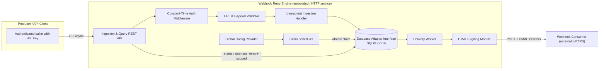
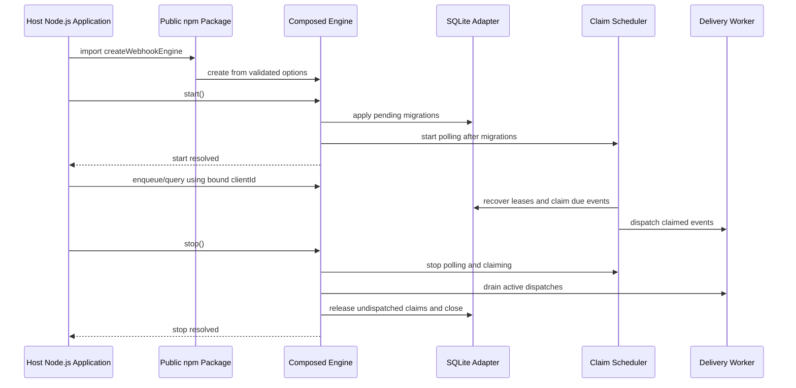
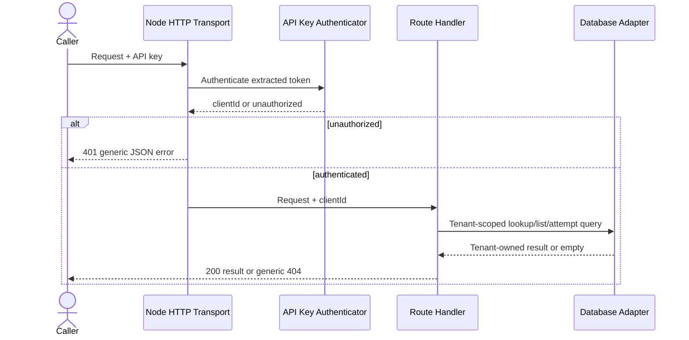
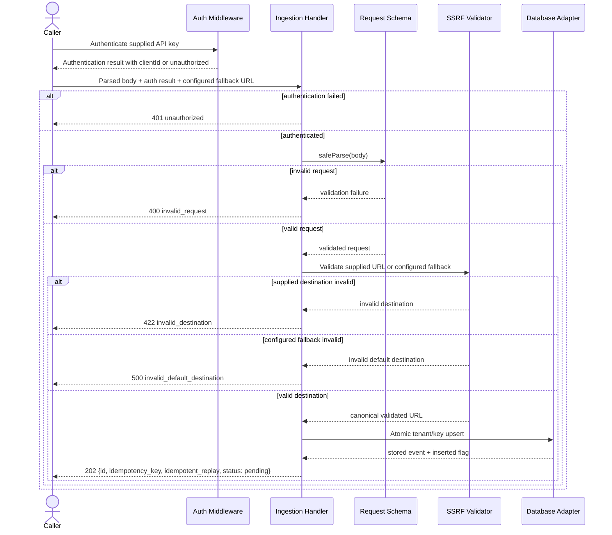
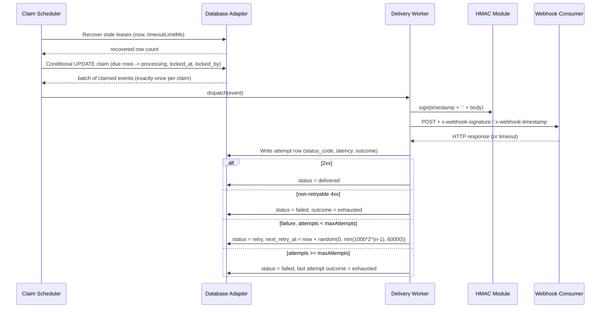

# SDD — Webhook Retry Engine

| Field            | Value                                                    |
| ---------------- | -------------------------------------------------------- |
| **Status**       | Approved (v1.0.0); WBS 6.3 design approved |
| **Owner**        | Product Engineer (Hamid Javadi)                          |
| **Date**         | 2026-10-15                                               |
| **Version**      | 1.0.0                                                    |
| **Template**     | `.agent-rules/templates/SDD-template.md`                 |
| **Linked PRD**   | `PRD.md` (v1.0.0, Approved/Baseline)                     |
| **Linked Scope** | `scope.md` (v1.0.0, Approved/Baseline)                   |
| **Linked WBS**   | `WBS.md` (v1.0.0, Approved / Ready for SDD)              |
| **Linked Risks** | `risks.md`                                               |
| **Related ADRs** | `docs/02-design/adr/`                                      |

---

## 1. Context, Goals, and Constraints

### 1.1 Context

The Webhook Retry Engine is a lightweight, embeddable Node.js (≥ 24.x) and TypeScript library and optional standalone HTTP service that delivers outgoing webhooks to external consumer endpoints with durable persistence, idempotent ingestion, bounded retries, and full attempt observability. Today, single-shot HTTP POSTs to the configured `WEBHOOK_URL` silently discard events on any transient failure (network error, HTTP 5xx, timeout, 429), re-deliver duplicates after restarts, and provide no audit trail. The engine closes these gaps without introducing external message brokers (no Redis, Kafka, or RabbitMQ — constraint C2).

### 1.2 Goals (traceable to PRD §4)

- **G1 — No silent loss:** every accepted event terminates in exactly one of `delivered`, `retry`, or `failed` with a complete recorded attempt history.
- **G2 — Idempotency:** duplicate ingestion of the same (`client_id`, `idempotency_key`) pair creates exactly one delivery job, including under ≥ 1000-subject concurrent submission.
- **G3/G4 — Reliability and concurrency safety:** bounded exponential backoff with full jitter; the driver-neutral claim contract is implemented for SQLite in v1.0 and guarantees no concurrent double-claims with WAL mode.
- **G5 — Security:** constant-time API-key authentication on ingestion; HMAC SHA-256 signed deliveries with timestamp; strict tenant isolation (BOLA/IDOR prevention); SSRF-safe destination validation.
- **G6/G7 — Performance and observability:** p95 ingestion latency < 50 ms (SQLite local); idle claim overhead < 10% CPU; ≥ 200 events/s sustained ingestion; per-attempt records for 100% of attempts.
- **G8 — Quality:** Vitest coverage ≥ 80% overall and ≥ 95% on critical paths (ingestion, atomic claim, retry scheduler, auth, HMAC).

### 1.3 Non-Goals (Out of Scope, per `scope.md` §3)

Per-tenant configuration and retry policies; admin UI/dashboard; Prometheus/OTel metrics export (structured JSON logs only); dead-letter re-drive/replay tooling; inter-event priority or ordering guarantees; multi-node scheduling coordination beyond the atomic claim guarantee; non-HTTP transports; signing schemes other than HMAC SHA-256; consumer-side verification SDK; alternative databases (MongoDB, Redis).

### 1.4 Constraints

| ID  | Constraint                        | Design Impact                                                                                                  |
| --- | --------------------------------- | -------------------------------------------------------------------------------------------------------------- |
| C1  | Node.js ≥ 24.x, TypeScript strict | Native `fetch`, `crypto.timingSafeEqual`, strict null checks throughout                                        |
| C2  | Zero heavy brokers                | Embedded SQL persistence + in-process scheduler; queue semantics implemented over relational rows              |
| C3  | Master-rule governance            | Schema/API/technology choices finalized only at the design checkpoint with user approval                       |
| C4  | At-least-once delivery            | Consumers deduplicate by system-generated event `id` (delivered in header and body); no exactly-once guarantee |

---

## 2. Architecture and System Boundaries

### 2.1 High-Level View



### 2.2 System Boundaries

- **Inside the boundary:** ingestion API, authentication middleware, validation, idempotent enqueue, claim scheduler, delivery worker, backoff computation, HMAC signing, attempt audit persistence, DB adapters, migration runner, structured logging.
- **Outside the boundary:** the producer's application (embeds or calls the engine), the external webhook consumer (verifies HMAC at its own discretion), database server administration, reverse proxies/TLS termination.
- **Deployment modes:** (a) the primary v1 delivery is a public npm package imported into a host Node.js process; the host owns its process, HTTP listener, and signal handlers. (b) An optional standalone HTTP service can use the same engine and transport modules, but requires a separate runnable composition entry point. The package import entry point is not a CLI or process runner.

### 2.3 Data Flow Summary

Ingestion path (synchronous, fast): HTTP transport extracts credentials and parses the request; the embedded package accepts typed input through its public facade, which binds the engine instance's configured `clientId`. Both paths call the shared handler, which validates the strict request schema, resolves and SSRF-validates the effective destination, constructs a server-owned event, and calls the adapter's atomic upsert on `UNIQUE(client_id, idempotency_key)` → returns an application-level result with `{ id, idempotency_key, idempotent_replay, status: "pending" }`. WBS 3.3 does not register routes, parse raw HTTP bodies, or start a server. Delivery path (asynchronous): scheduler polls due rows → atomic conditional `UPDATE` claim → worker dispatch with HMAC-signed request → attempt row written → status transition (`delivered` / `retry` with `next_retry_at` / `failed`).

### 2.4 Embedded npm Package and Engine Lifecycle (WBS 6.2)

The package is published publicly as `webhook-delivery-engine` and consumed through the package root. `src/index.ts` is the stable ESM entry point and exports `createWebhookEngine(...)` plus the public TypeScript option, input, and result types. The published package metadata points `exports` and `types` at the built JavaScript and declaration files and includes the SQLite migration assets required at runtime. The embedded API does not start an HTTP listener or register process signal handlers.

`createWebhookEngine(options)` returns a typed engine with `start()`, `stop()`, and programmatic ingestion and tenant-scoped query methods. The configured `clientId` is bound to that engine instance; callers cannot override it per request. `start()` applies pending migrations before starting the scheduler and resolving. Calls that enqueue or query events are accepted only after startup succeeds. The configured `workerCount` bounds active delivery callbacks; additional claimed events remain queued and undispatched. `stop()` is idempotent: it prevents queued callbacks from starting, stops polling and claiming, releases queued claims, waits for already-started callbacks (including attempt persistence) to finish within their configured request timeouts, and closes engine-owned resources. The host application installs signal handlers and awaits `stop()` during its shutdown. The structured logger records safe poll and delivery error context; optional `onError` receives the original error and, for delivery failures, the event.

v1 supports one configured client per engine instance. Because schedulers claim due events across all tenants in the database and dispatch signs with the instance's configured HMAC secret, multiple tenant configurations must not share a database file in v1. Host-managed runtime registration and tenant-specific dispatch configuration are deferred to v2.0.0 (WBS 6.4); the host will remain responsible for the source of client configuration.

The host supplies runtime configuration and a persistent SQLite location to the factory; the engine owns the adapter it creates and closes it on stop. The implementation reuses the existing ingestion validation/idempotency path, dispatcher, scheduler, and tenant-scoped adapter queries rather than exposing internal handlers or requiring the host to compose feature modules.



### 2.5 Structured JSON Logger (WBS 6.3)

The engine will use the existing `pino` runtime dependency through a small `src/shared/logger.ts` module. `createWebhookEngine` will accept an optional typed `logLevel`; when omitted it will use `LOG_LEVEL`, then default to `info`. Supported values are `fatal`, `error`, `warn`, `info`, `debug`, `trace`, and `silent`; invalid values fail during engine construction. Records are newline-delimited JSON written through Pino's standard output destination.

The composition root will pass the logger through narrow logging callbacks so feature modules do not write directly to the console. Records will identify lifecycle events such as engine start/stop, stale-lease recovery counts, accepted events, claims, dispatch starts, attempt outcomes and persistence results, and scheduler/delivery failures. Records may include event and tenant identifiers, attempt number, status code, latency, and safe error type. They must not include payloads, request bodies, arbitrary event headers, API keys, HMAC secrets, raw exception messages, or stacks.

Pino redaction will remove known sensitive fields (including case variants of `Authorization` and `x-api-key`, API/HMAC key fields, payload/body fields, and nested event/request equivalents) as defense in depth. Internal logging will use explicit safe fields and fixed error type labels rather than serializing `WebhookEvent` or raw error objects. The host remains free to configure process output routing; this task does not add a transport, file sink, or telemetry exporter.

Tests will verify the supported level selection and filtering, JSON record shape, event context, redaction of sensitive values at nested paths, and that poll/delivery errors do not leak raw messages or stacks.

---

## 3. Modules and Responsibilities

| Module                                 | Responsibility                                                                                                                                                                                                                                           | Key Dependencies                 |
| -------------------------------------- | -------------------------------------------------------------------------------------------------------------------------------------------------------------------------------------------------------------------------------------------------------- | -------------------------------- |
| **Domain Types** (WBS 1.2)             | `WebhookEvent`, `AttemptRecord`, `DatabaseAdapter`, `EngineConfig` contracts; the stable seam all modules program against.                                                                                                                               | None                             |
| **Persistence Adapter** (WBS 2.3)      | Storage-owned `SqliteDatabaseAdapter` opens better-sqlite3, configures WAL, `busy_timeout=5000`, and foreign keys, applies SQLite migrations before returning, and implements `DatabaseAdapter` with parameterized SQL. PostgreSQL/MySQL adapters are deferred to v2.0. | Domain Types, Migration Runner   |
| **Migration Runner** (WBS 2.2)         | Idempotent, in-process SQLite DDL migrations; no external CLI. Version/hash ledger and transactional application of scripts under `src/storage/migrations/sql/sqlite/`. | SQLite connection                |
| **Auth Middleware** (WBS 3.1)          | Validates one configured API key using SHA-256 fixed-length digests and `crypto.timingSafeEqual`; returns the configured `clientId` on success and a uniform unauthorized result otherwise. HTTP transport maps that result to 401. | Auth configuration               |
| **Validator / SSRF Guard** (WBS 3.2)   | Strict Zod ingestion-body schema and absolute-HTTPS URL validation; resolves hostnames and rejects any unsafe IPv4/IPv6 answer before dispatch. Uses Node built-ins and fails closed on lookup errors or empty results. | Domain Types, Node DNS/net, Zod |
| **Ingestion Handler** (WBS 3.3)        | Accepts parsed input and an auth result; rejects unauthenticated or invalid requests before persistence, uses validated configured `WEBHOOK_URL` only when destination is omitted, constructs a server-owned pending event, and calls the atomic upsert. Returns the existing system id on replay without overwriting the accepted event. It is not an HTTP route/server. | DatabaseAdapter, Auth, Validator, configuration |
| **Claim Scheduler** (WBS 4.1)      | Poll loop: invokes SQLite stale-lease recovery once per cycle, then atomically claims due rows and emits claimed batches to workers.                                                                                                                           | Adapters, Config Provider        |
| **Delivery Worker** (WBS 5.x) | Per-event dispatch with `timeoutLimitMs` abort; outcome classification per ADR-0004 (2xx success; non-retryable 4xx terminally fail with `outcome='exhausted'`; retryable 408, 409, 429, 5xx, and timeouts retry until `maxAttempts`); atomically writes attempt rows and applies status transitions (FR-6). | Scheduler, HMAC Module, Adapters    |
| **HMAC Signing Module** (WBS 5.x)      | Computes `HMAC-SHA256(secret, timestamp + '.' + body)`; injects `x-webhook-signature` and `x-webhook-timestamp` headers; refuses unsigned dispatch (FR-13).                                                                                              | Config                           |
| **Config Provider** (WBS 5.x)          | Validates and exposes `timeoutLimitMs` (default 10 000), `maxAttempts` (default 5), backoff `base=1000`, `capMs=60000`, poll interval, batch size (default 10); re-read per cycle for hot-reload; safe fallback to defaults on invalid values (risk R5). | None                             |
| **Query API** (WBS 6.x)                | Tenant-scoped reads of event status and attempt history; every query carries `AND client_id = :authClientId`; cross-tenant access returns `404` (NFR-S7).                                                                                                | Adapters, Auth                   |
| **Engine Composition & Lifecycle** (WBS 6.2) | Public package factory composes migrations, SQLite adapter, ingestion/query facade, scheduler, and delivery worker; exposes explicit asynchronous start/stop lifecycle for the host process. | Existing application modules |
| **Structured Logger** (WBS 6.3)        | Pino-backed JSON lifecycle logging with configured level and mandatory redaction of credentials, HMAC secrets, payloads, and request bodies (risk R6).                                                                                                      | Pino, Engine Composition         |

High cohesion / low coupling: every module depends only on the `DatabaseAdapter` and `EngineConfig` contracts; no module imports a concrete driver directly. This isolates dialect quirks (risk R7) behind the adapter seam.

### 3.1 Core Contract Invariants

- Canonical contracts live in `src/core/types.ts` and `src/core/ports.ts`; `EngineConfig` lives in `src/config/engine.config.ts`. The core has no runtime dependencies. All contract properties and nested JSON values are readonly. Domain timestamps use UTC ISO-8601 strings so they remain immutable and driver-agnostic.
- `WebhookEvent` carries the system `id`, tenant-scoped `idempotencyKey` and `clientId`, SSRF-validated `destinationUrl`, JSON `payload`, JSON `metadata`, delivery `headers`, lifecycle `status`, `attemptCount`, retry/lease fields, and creation/update timestamps. Event-specific headers are persisted as data; engine-owned signing and event-identification headers cannot be overridden by them.
- `AttemptRecord` is append-only and records `eventId`, its 1-based `attemptNumber`, `attemptedAt`, nullable HTTP `statusCode`, bounded nullable `responseSnippet`, nullable error description, nullable `latencyMs`, and an `outcome` of `success`, `retry_scheduled`, or `exhausted`. `exhausted` marks a terminal unsuccessful attempt, including an immediate permanent failure from a non-retryable response as well as retry exhaustion at `maxAttempts`.
- `DatabaseAdapter` owns atomic idempotent upsert, due-row claim, stale-lease recovery, worker-owned lease release, tenant-scoped event reads/listing, attempt-history reads, and atomic attempt-record-plus-event-transition operations. Claiming transitions eligible `pending`/`retry` rows to `processing`, sets lease metadata, and increments `attemptCount`. Appending an attempt and applying its resulting state transition are one database transaction; a transition succeeds only for the worker holding the lease. Read methods must scope by `clientId`.
- `EngineConfig` is readonly and groups worker concurrency, polling/batch limits, request timeout, and retry policy (`maxAttempts`, `baseDelayMs`, `maxDelayMs`). SDD defaults are timeout 10,000 ms, max attempts 5, base delay 1,000 ms, max delay 60,000 ms, and batch size 10. Concurrency and timing values must be positive safe integers; retry maximum must not be less than its base.

---

## 4. Data Model and Migration

### 4.1 `webhook_events` — one row per unique event (idempotency anchor)

| Column                      | Canonical Type      | Constraints / Notes                                                                |
| --------------------------- | ------------------- | ---------------------------------------------------------------------------------- |
| `id`                        | UUIDv4 (PK)         | System-generated, cryptographically random, non-enumerable; never client-supplied. |
| `idempotency_key`           | TEXT                | Client-supplied; uniqueness scoped per client.                                     |
| `client_id`                 | TEXT                | Resolved from authenticated caller; part of `UNIQUE(client_id, idempotency_key)`.  |
| `destination_url`           | TEXT                | Fully qualified HTTPS URL, SSRF-validated at ingestion.                            |
| `payload`                   | TEXT (JSON)         | Delivered body.                                                                    |
| `metadata`                  | TEXT (JSON)         | Immutable JSON metadata associated with the accepted event.                        |
| `headers`                   | TEXT (JSON)         | Event-specific outbound headers; reserved engine-owned headers are not overridable. |
| `status`                    | TEXT enum           | `pending` \| `processing` \| `delivered` \| `retry` \| `failed`.                   |
| `attempt_count`             | INTEGER, default 0  | Number of dispatches made.                                                         |
| `next_retry_at`             | TIMESTAMP, nullable | Indexed for claim query; NULL for fresh `pending` rows.                            |
| `locked_at`                 | TIMESTAMP, nullable | Lease acquisition time.                                                            |
| `locked_by`                 | TEXT, nullable      | Worker identifier holding the lease.                                               |
| `created_at` / `updated_at` | TIMESTAMP           | Row timestamps.                                                                    |

Indexes: PK on `id`; `UNIQUE(client_id, idempotency_key)` (idempotency anchor); `idx_webhook_events_due (status, next_retry_at)` (claim query).

### 4.2 `webhook_event_attempts` — append-only audit trail

| Column             | Type      | Notes                                                     |
| ------------------ | --------- | --------------------------------------------------------- |
| `id`               | TEXT      | SQLite text primary key.                                   |
| `event_id`         | TEXT      | NOT NULL, FK → `webhook_events.id` **ON DELETE CASCADE**. |
| `attempt_number`   | INTEGER   | 1-based ordinal.                                          |
| `attempted_at`     | TEXT      | UTC ISO-8601 attempt start.                               |
| `status_code`      | INTEGER   | NULL on network error/timeout.                            |
| `response_snippet` | TEXT      | Bounded ≤ 1 KB, contractually secret-free (A6).           |
| `error`            | TEXT      | Error text (e.g., `timeout`, `ECONNREFUSED`).             |
| `latency_ms`       | INTEGER   | Round-trip duration.                                      |
| `outcome`          | TEXT enum | `success` \| `retry_scheduled` \| `exhausted`; `exhausted` means terminal unsuccessful delivery, including permanent 4xx failure or reaching `maxAttempts`. |

Unique composite index: `uq_webhook_event_attempts_event_number (event_id, attempt_number)`, enforcing one append-only record per event attempt ordinal.

### 4.3 Dialect Mapping and Validation

- **SQLite (v1.0):** TEXT ids, JSON encoded as validated TEXT, ISO-8601 strings for timestamps, WAL mode, `busy_timeout = 5000 ms`, single-statement conditional `UPDATE ... RETURNING` claims, and `BEGIN IMMEDIATE` for multi-statement attempt/state transitions (mitigates R1).
- PostgreSQL and MySQL dialect mappings, schemas, drivers, and adapters are deferred to v2.0 and are not shipped or supported by the v1.0 runtime.
- Validation of all persisted values is enforced at the module boundary (Zod/Valibot schemas at startup and ingestion).

### 4.4 SQLite Adapter Behavior

`src/storage/sqlite.adapter.ts` is the sole production module that imports `better-sqlite3` or contains adapter SQL. Its asynchronous `open` factory accepts a database filename, opens the connection, enables WAL, sets `busy_timeout=5000` and foreign-key enforcement, applies the bundled SQLite migration, and returns the adapter only after initialization succeeds. If setup or migration fails, it closes the connection and propagates the error. The adapter exposes `close()` for owner-controlled shutdown; downstream modules consume only `DatabaseAdapter`.

All writes are parameterized. JSON values are validated and serialized to JSON text at write boundaries and parsed/validated when read; timestamps are validated and stored as normalized UTC ISO-8601 strings. Tenant-scoped lookup/list/attempt queries always bind `client_id`. Pagination is bounded to 1–1,000 rows and orders by `(created_at, id)` to provide a stable cursor.

Claiming uses the single-statement atomic conditional `UPDATE ... RETURNING` pattern from ADR-0001. The inner ordered limited subquery selects only due `pending`/`retry` rows; the same `UPDATE` sets `processing`, lease owner/time, increments the reserved attempt count, updates the timestamp, and returns each claimed event. It does not select candidate IDs into application memory or issue a separate update/read query, and does not require an explicit surrounding transaction because the SQLite statement itself is atomic. Per the approved WBS 2.6 design checkpoint, `ClaimDueEventsInput.now` supplies one validated UTC ISO-8601 reference timestamp used for due-time comparison, lease acquisition, and update time. This preserves the driver-neutral contract and avoids lexically comparing ISO-8601 text with SQLite's differently formatted `CURRENT_TIMESTAMP`; all claim decisions within a call use the same clock value.

The SQLite adapter's stale-lease recovery accepts a caller-supplied UTC `now` and positive safe-integer `timeoutLimitMs`. It computes `staleThresholdMs = max(timeoutLimitMs + 30000, 90000)`, `staleBefore = now - staleThresholdMs`, and `nextRetryAt = now + 10000 ms`. A single parameterized `UPDATE` changes only rows with `status = 'processing' AND locked_at < staleBefore` to `retry`, clears `locked_at`/`locked_by`, and records the retry/update timestamps. The strict comparison preserves leases exactly at the cutoff; SQL statement atomicity prevents partial recovery. Invalid timeout or timestamp input rejects before writing. The adapter operation is implemented by WBS 2.7; the scheduler poll loop must call it once each cycle under WBS 4.1 and is not part of Task 2.7.

Lease release only changes a lease owned by the requesting worker and reverses its reserved attempt count. Attempt insertion and the corresponding terminal/retry event transition are one `BEGIN IMMEDIATE` transaction: validate the current lease and next attempt ordinal, append the audit row, update state and retry time, and clear lease fields. A stale owner or invalid transition returns `false` without partial writes; database/serialization errors reject the operation.

### 4.5 Migration Policy

Migrations are hand-written, forward-only SQL versioned in-repo under `src/storage/migrations/sql/sqlite/` and applied by the in-house SQLite runner. The runner owns `schema_migrations(version, checksum, applied_at)`, loads SQL files in version order, computes SHA-256 checksums, skips already-applied files with matching checksums, rejects changed or missing applied files, and applies each pending set within one SQLite `BEGIN IMMEDIATE`/`COMMIT` transaction (rolling back on failure). The DDL files do not start nested transactions. PostgreSQL and MySQL migrations are deferred to v2.0. No down-migrations or destructive auto-migrations are supported; a schema change requires an ADR (see §10).

The runner is implemented at `src/storage/migrations/runner.ts` against the SQLite connection surface, with all database operations confined to storage. Runtime composition awaits `SqliteDatabaseAdapter.open()` before starting the scheduler or server; that factory owns connection configuration and migrations. `src/app/bootstrap.ts` remains a lower-level migration seam for callers that manage a raw SQLite connection and must not be layered around `open()` for the same database. Automated migration/schema tests use Node.js `node:sqlite`; adapter integration tests use better-sqlite3 on temporary files. No PostgreSQL/MySQL test services or environment variables are required for v1.0. The core domain has no driver dependencies.

### 4.6 Sensitive Data and Retention

Secrets (`API_KEY`, `HMAC_SECRET`, DB credentials) live only in environment configuration, never in the database, logs, or VCS. Payloads and response snippets are stored for the lifetime of the event row; retention beyond that is operator-managed (v1 provides no automatic purge — consistent with the out-of-scope DLQ/re-drive deferral).

---

## 5. API / Event Contracts

Base path: `/webhooks`. All routes require `Authorization: Bearer <token>` or `x-api-key` (FR-7). Versioning: path-prefix reserved (`/v1`) for future breaking changes; v1 endpoints unversioned under the configured `PORT`.

### 5.1 `POST /webhooks` — Idempotent Ingestion

- **Request body:** `{ "idempotency_key": string (non-empty, required), "payload": JSON (required), "destination_url": string (optional; defaults to configured WEBHOOK_URL) }`. The schema is strict and rejects unknown properties; `client_id` is derived from authenticated identity, and the client MUST NOT supply `id` or timestamps (FR-18). The payload must be recursively JSON-compatible (finite numbers, strings, booleans, null, arrays, and string-keyed objects).
- **Success:** `202 Accepted` with `{ "id": <system UUID>, "idempotency_key": <key>, "idempotent_replay": true|false, "status": "pending" }` (FR-2).
- **Errors:** `401 Unauthorized` (missing/invalid key, FR-9); `400 Bad Request` (schema violation); `422 Unprocessable Entity` (invalid/unsafe caller-supplied URL); `429 Too Many Requests` (fixed-window rate limit, NFR-S5); `503` on storage unavailability (NFR-R3). WBS 3.3 implements the internal handler contract, not this route or wire-level response mapping.
- **Idempotency:** enforced by a single-statement atomic upsert against `UNIQUE(client_id, idempotency_key)`; concurrent duplicate submissions (≥ 1000 parallel, AC2) yield exactly one row and `idempotent_replay: true` on replays.

### 5.2 `GET /webhooks` — List Events

- **Query:** `status` (optional filter), cursor pagination.
- **Success:** `200` with event summaries, strictly scoped `WHERE client_id = :authClientId` (NFR-S7).
- **Errors:** `401`, `400` (invalid filter).

### 5.3 `GET /webhooks/:id` — Event Status

- Addressable by system `id` or `idempotency_key`; query carries `AND client_id = :authClientId`; any cross-tenant lookup returns **`404 Not Found`** (never `403`) to prevent metadata leakage/BOLA (FR-19, NFR-S7).

### 5.4 `GET /webhooks/:id/attempts` — Attempt History

- Chronological attempt rows (number, timestamp, status code/error, latency, outcome) for the tenant-scoped event. Errors: `401`, `404` (cross-tenant or unknown id).

### 5.9 REST Transport Design (WBS 6.1)

The optional standalone HTTP transport uses Node's built-in `node:http` server, avoiding a new runtime dependency. Route registration and request/response mapping live in `src/features/ingestion/ingestion.routes.ts` and `src/features/query/query.routes.ts`; `src/app/http.server.ts` creates a server but does not listen or start a process. A standalone host entry point must compose the engine and server separately. The embedded package factory does not bind a listener. The transport calls the existing ingestion handler and `DatabaseAdapter` query methods rather than duplicating validation, persistence, or tenant rules. `src/security/auth.ts` remains the sole API-key authenticator. When both supported credential headers are present, `Authorization: Bearer` takes precedence; malformed authorization does not fall back to `x-api-key`.

Query parameters are `status`, `limit`, and opaque `cursor`; unknown or invalid values return a generic `400 invalid_request`. `status` must be one of the canonical `EventStatus` values. `limit` is an integer from 1 through the adapter's 1,000-row maximum, defaulting to 100. A successful list is `{ "items": [...], "next_cursor": string | null }`. Items are event records serialized with snake_case wire keys, including delivery state and timestamps. Detail lookup first attempts the system id, then the tenant-scoped idempotency key; both paths use adapter methods that include `clientId`, and a miss returns the same generic `404 not_found`. Detail success returns the serialized event record. Attempts success returns `{ "items": [...] }` in attempt-number order and first verifies the tenant-scoped parent event exists so unknown and cross-tenant ids have identical `404` behavior.

All four endpoints require authentication. The transport extracts a Bearer token or `x-api-key`, then passes only the authenticator result's `clientId` to ingestion and read methods. It returns generic JSON errors, never adapter, DNS, credential, or stack details. Malformed JSON and unsupported methods return `400` and `405` respectively; database failures return `503`. The query API has no write operations. No new schema or migration is required because `DatabaseAdapter` already exposes tenant-scoped lookup, pagination, and attempt-history methods.



### 5.5 Outbound Delivery Contract (event egress)

- `POST` to `destination_url` with headers: `x-webhook-signature: sha256=<hex HMAC-SHA256(secret, timestamp + '.' + body)>`, `x-webhook-timestamp: <unix seconds>`, `x-webhook-event-id: <system id>`, and the event `id` embedded in the body (FR-11/FR-12, A2). No request is ever dispatched unsigned (FR-13).

---

### 5.6 API-Key Authentication Contract (WBS 3.1; FR-7–FR-10)

`src/security/auth.ts` exports a factory that accepts an immutable configuration containing one non-empty `apiKey` and its non-empty `clientId`, and returns an authenticator accepting a candidate token or `undefined`. The factory computes and retains only the configured credential's SHA-256 digest. Each authentication call hashes the candidate (using an empty sentinel when absent) and compares the fixed-length digests with `crypto.timingSafeEqual`; there is no secret-length early return or direct secret equality comparison. Configuration errors fail during authenticator creation, before handling requests.

The result is a discriminated union: success contains only the configured `clientId`; failure contains the common unauthorized status code `401`. Missing, malformed/absent, and wrong tokens share that failure shape. The authenticator never logs or returns credentials. The HTTP transport is responsible for extracting a Bearer or `x-api-key` value and translating the failure result to an HTTP response; the transport itself is not part of WBS 3.1.

v1 configures a single API key/client identity pair; multi-key registries and per-tenant credential management are out of scope. The `clientId` returned on success is the only identity value downstream ingestion may use for tenant stamping. No retry, circuit breaker, or CORS behavior is part of this authentication contract.

### 5.7 Payload and Destination Validation Contract (WBS 3.2; NFR-S6, AC14)

`src/features/ingestion/ingestion.schema.ts` exports the strict Zod schema for the parsed request body and its inferred input type. It accepts only a non-empty `idempotency_key`, a recursive JSON `payload`, and an optional string `destination_url`; omitted destination URLs are resolved to configured `WEBHOOK_URL` by the later ingestion handler and that effective URL is subject to the same validation. Malformed JSON parsing remains the HTTP transport's responsibility. Tenant identity and timestamps are server-derived and are not accepted from the caller.

`src/security/ssrf.ts` exports an asynchronous destination validator. It parses with the WHATWG `URL` implementation, requires `https:`, a hostname, and no username/password, and returns a discriminated validation result that contains no resolved addresses or raw resolver errors. Invalid syntax, unsupported protocols, embedded credentials, unsafe targets, empty DNS results, and resolver failures fail closed and map to one generic `422` destination error; schema violations map to `400`. Hostnames use Node's `lookup` with `{ all: true, verbatim: true }`; tests mock this DNS boundary with deterministic results. Validation opens no HTTP connection or socket to the destination.

IP literals are canonicalized by URL parsing and classified directly without DNS. `localhost` and any subdomain of `.localhost` are rejected explicitly, including trailing-dot/case variants. Other hostnames are resolved with Node's `node:dns/promises` lookup requesting all address records. If any returned A or AAAA address is unsafe, the whole hostname is rejected (including mixed public/private answers); an empty result or lookup error is rejected. The address classifier rejects IPv4/IPv6 loopback, unspecified, private (RFC 1918 and IPv6 ULA), link-local, multicast, reserved/special-use ranges, cloud metadata (`169.254.169.254`), and IPv4-mapped IPv6 addresses when the embedded IPv4 address is unsafe. Node's `node:net` IP parser and explicit CIDR comparisons are used; no IP-classification dependency is introduced.

This preflight lookup is not an address pin. DNS can change between validation and connection, so WBS 5.2 must revalidate and bind the connection to a safe resolved address, and redirects must be disabled or every redirect target must receive the same validation. WBS 3.2 does not implement dispatch, TLS configuration, or redirect handling. Unit tests mock the DNS boundary and make no external DNS/network requests.

### 5.8 Idempotent Ingestion Handler Contract (WBS 3.3; FR-1, FR-2, FR-18; AC1, AC2)

`src/features/ingestion/ingestion.handler.ts` exports the application handler. It receives a `DatabaseAdapter`, an `ApiKeyAuthenticationResult`, an untrusted parsed request body (`unknown`), and the configured fallback `WEBHOOK_URL`. It does not parse raw JSON, extract headers, authenticate a token itself, register an HTTP route, or start a server. HTTP transport and embedded callers must use the same handler contract.

The handler processes input in this order:

1. Return the common `401` unauthorized result immediately when authentication failed; do not validate destination DNS or call the adapter.
2. Validate the parsed body with `ingestionRequestSchema.safeParse`. Reject unknown fields, caller-supplied identity, and malformed payloads with a generic `400 invalid_request` result that does not echo the payload or schema internals.
3. Select the supplied `destination_url` or, only when omitted, configured `WEBHOOK_URL`; run the selected URL through `validateDestinationUrl`. A rejected caller-supplied destination returns generic `422 invalid_destination`. A rejected configured fallback returns generic `500 invalid_default_destination` because this is an engine configuration fault, not a client input fault. Both paths stop before persistence; resolver details and addresses are never included in results.
4. Construct a `WebhookEvent` using `randomUUID()` for `id`, the authenticated `clientId`, the schema-validated idempotency key and payload, the canonical validated destination, empty metadata and event-specific headers, `status: 'pending'`, `attemptCount: 0`, null retry/lease fields, and one server-generated UTC timestamp for `createdAt` and `updatedAt`.
5. Call `DatabaseAdapter.upsertEvent` once. The adapter's unique constraint and atomic upsert are the concurrency boundary; the handler performs no check-then-insert, in-memory lock, or second persistence write. A rejected adapter promise propagates unchanged; it is not converted to a success-shaped result. The future HTTP transport maps storage failures to `503`.
6. Return `{ statusCode: 202, body: { id, idempotency_key, idempotent_replay, status: 'pending' } }` using the stored event's id/key and `idempotent_replay: !inserted`. On replay, return the existing event id and do not overwrite the accepted payload, destination, or other stored state. `status: 'pending'` is the ingestion acknowledgment shape required by FR-18; it is not a live-state read if the event has since advanced, and status queries remain authoritative.

The handler result is a discriminated union: success (`202`), unauthorized (`401`), invalid request (`400`), invalid caller destination (`422`), or invalid configured fallback (`500`). Database failures reject rather than forming a handler result and are translated to `503` by the eventual transport boundary. No rate limiting, route implementation, raw-body parsing, logging framework, or dispatcher behavior is added by WBS 3.3.

## 6. Key Flows

### 6.1 Idempotent Ingestion Flow



### 6.2 Claim, Deliver, and Retry Flow



### 6.3 Stale-Lease Recovery Flow (FR-5, AC9; ADR-0002)

The caller supplies one UTC reference time and the active `timeoutLimitMs` to the SQLite adapter. The adapter derives `staleThresholdMs = max(timeoutLimitMs + 30000, 90000)` and recovers only processing leases strictly older than `now - staleThresholdMs`. In one parameterized atomic `UPDATE`, it sets `status = 'retry'`, clears `locked_at` and `locked_by`, sets `next_retry_at = now + 10000 ms`, and updates the row timestamp. Active leases, rows at the cutoff, and rows not in `processing` are unchanged. Recovery errors propagate; invalid inputs are rejected before any write. Recovery returns the number of rows updated.

WBS 2.7 implements this adapter operation and its threshold/boundary tests. The WBS 4.1 scheduler poll loop is responsible for calling recovery once per cycle before claiming due events. This task does not implement that loop. The operation uses the supplied UTC reference time rather than SQLite's clock so cutoff and retry boundaries are deterministic and remain consistent with the adapter's ISO-8601 timestamp contract.

**Invariants:** no two live workers hold a claim on the same event (AC3); no attempt beyond `maxAttempts`; no retries after a terminal state (FR-16); every attempt is recorded before the next status transition (AC10).

---

## 7. Security, Privacy, and Failure Modes

### 7.1 Security and Privacy

- **Authentication (NFR-S1):** `src/security/auth.ts` compares equal-length SHA-256 digests with `crypto.timingSafeEqual`, including absent credentials via a fixed sentinel; returns a uniform unauthorized result mapped to `401`, and exposes the configured `clientId` only after successful verification (mitigates R3; AC7, AC12).
- **Delivery integrity and replay defense (NFR-S2):** HMAC SHA-256 over `timestamp.body` with the configured secret; timestamp material defeats replay of stale captures.
- **Tenant isolation (NFR-S7):** non-enumerable UUIDv4 ids plus mandatory `client_id` scoping on every read; cross-tenant attempts return `404` (BOLA/IDOR prevention).
- **SSRF protection (NFR-S6, AC14):** URL allow-policy enforcing HTTPS, resolving and rejecting loopback, RFC 1918, link-local, and `169.254.169.254` metadata targets before any socket is opened.
- **SSRF preflight limits:** WBS 3.2 fails closed for unsafe literal/resolved IPv4/IPv6 addresses, malformed/non-HTTPS URLs, credentials in URLs, empty DNS results, and resolver failures. The validator does not dispatch or pin a socket; WBS 5.2 must revalidate/pin before connecting and validate redirect targets or disable redirects to mitigate DNS rebinding.
- **SQL safety (NFR-S4):** parameterized/prepared statements exclusively in the SQLite adapter.
- **Secret hygiene (NFR-S3):** env-only secrets; structured logger redactors for `Authorization`, `x-api-key`, HMAC secret, and payloads (mitigates R6).
- **Rate limiting (NFR-S5):** basic fixed window on ingestion protects the embedded DB.
- **Privacy:** payloads are operator-supplied business data; storage is local to the configured database; no third-party data flows.

### 7.2 Failure Modes and Recovery

| Failure                            | Behavior                                                                                                          | Requirement  |
| ---------------------------------- | ----------------------------------------------------------------------------------------------------------------- | ------------ |
| Non-retryable 4xx                  | Attempt recorded with `outcome='exhausted'`; event becomes terminal `failed`, with no retry scheduled               | FR-17, ADR-0004 |
| Consumer 5xx / network error / 429 | Attempt recorded (`error` or `status_code`), backoff with full jitter applied, `retry` scheduled                  | FR-6, FR-14  |
| Delivery exceeds `timeoutLimitMs`  | Request aborted, attempt row with `error: timeout`, retry scheduled                                               | AC6          |
| Worker crash mid-dispatch          | Stale lease reclaimed after threshold; delivery may repeat (at-least-once, C4)                                    | FR-5, AC9    |
| Process restart                    | All events/attempts/config persist; scheduler resumes; in-flight rows reclaimed                                   | AC11, NFR-R1 |
| DB unavailability                  | Scheduler backs off and logs; host process remains healthy; ingestion returns `503`                               | NFR-R3       |
| SQLite write contention            | `BEGIN IMMEDIATE` + WAL + `busy_timeout`; throttled claim frequency; any move to PostgreSQL/MySQL requires the v2.0 adapter plan | R1 |
| Config misvalidation               | Safe fallback to defaults (base 1 s, cap 60 s, full jitter) on startup validation failure                         | R5           |

---

## 8. Observability, Performance, and Accessibility

- **Observability (G7):** structured JSON logs (`LOG_LEVEL`) for every lifecycle transition — claim, dispatch, attempt outcome, state change, recovery sweep. Full attempt audit queryable via `GET /webhooks/:id/attempts`. Log-based observability only in v1; Prometheus/OTel export deferred to v1.1.
- **Performance (G6, NFR-P1–P4):** p95 ingestion < 50 ms on local SQLite; claim poll interval configurable with idle CPU < 10%; batch claiming (default batch size 10) amortizes transaction overhead; ≥ 200 events/s sustained ingestion target.
- **Compatibility and accessibility:** backend library — UI accessibility standards do not apply; accessibility of concern is API ergonomics (consistent error shapes, documented contracts). Compatibility: Node ≥ 24.x, TypeScript strict, SQLite in v1.0; PostgreSQL/MySQL adapters deferred to v2.0; embedded and standalone modes (NFR-C4).

---

## 9. Testing and Deployment

### 9.1 Testing Strategy

| Layer              | Tooling                        | Coverage target                                                                     |
| ------------------ | ------------------------------ | ----------------------------------------------------------------------------------- |
| Unit               | Vitest                         | Backoff math, HMAC computation, SSRF guard, config validation, timing-safe auth     |
| Integration        | Vitest + mock endpoints        | Handler validation/result contract, ingestion idempotency (AC1/AC2), retry lifecycle (AC4–AC6), restart recovery (AC11) |
| SQLite concurrency | Vitest × SQLite                | ≥ 100 parallel claims with zero double-claims (AC3); ≥ 1,000 same-tenant duplicate ingestion submissions with one row and stable id (AC2) |
| Security suite     | Vitest                         | Auth (AC7), signatures (AC8/AC12), SSRF (AC14), tenant isolation                    |
| Fault injection    | Vitest                         | Worker crash recovery (AC9), DB outage backoff                                      |

Thresholds: ≥ 80% overall; ≥ 95% on ingestion, atomic claim, retry scheduler, auth, HMAC, and SSRF validation paths (G8, AC13). WBS 3.3 tests cover short-circuit auth, strict parsed-body schema, caller-vs-config destination errors, successful new/replay response shapes, tenant isolation, immutable original rows on replay, propagated adapter failures, and the 1,000-submission SQLite concurrency criterion. SSRF tests cover strict request schema behavior, URL syntax/protocol/credential rejection, IPv4/IPv6 special ranges, mapped addresses, all DNS answers, empty/error lookups, and no external network use. Verification requires actual recorded test results — claimed-but-not-run tests are prohibited by master rules.

### 9.2 Migration and Deployment

- Embedded deployment imports the public npm package into a host Node.js process; `start()` applies migrations before scheduler activation and `stop()` drains or safely releases work. A standalone HTTP service needs its own runnable server composition and is optional; the library import is not a process entry point.
- Embedded factory configuration (D4) is supplied by the host: SQLite location, default destination, delivery HMAC secret, configured client identity, and worker/retry settings. `PORT` and HTTP API-key settings apply only when the host also enables the optional HTTP transport; v1.0 has no PostgreSQL/MySQL connection settings.
- Rollback strategy: forward-only migrations; rollback is a previous release binary against a compatible schema (additive-only changes in v1.x).
- WBS traceability: design covers WBS 1.0–8.0; the implementation phase begins only after design-checkpoint approval per master rules.

---

## 10. Options, Trade-offs, and Related ADRs

| Decision               | Selected Option                                                                              | Rejected Alternatives & Rationale                                                                                      |
| ---------------------- | -------------------------------------------------------------------------------------------- | ---------------------------------------------------------------------------------------------------------------------- |
| Queue substrate        | Relational tables + atomic conditional `UPDATE` claim                                        | External broker (Redis/Kafka/RabbitMQ) — violates lightweight-embeddable constraint C2 and adds operational surface    |
| Claim primitive        | SQLite conditional `UPDATE ... WHERE status IN ('pending','retry')` returning affected rows | Row-locking designs are unnecessary for v1's SQLite-only scope and require a separate dialect decision in v2.0                         |
| Delivery semantics     | At-least-once with consumer deduplication by system `id`                                     | Exactly-once — impossible across crash windows without two-phase consumer acknowledgement; out of scope (C4)           |
| Retry policy           | Bounded exponential backoff with **full jitter**                                             | Fixed-interval retries — thundering-herd risk on struggling endpoints (R5)                                             |
| Non-2xx classification      | HTTP 2xx success; non-retryable client errors (400, 401, 403, 404, 410, 422, other 4xx by default) transition immediately to terminal `failed` with `outcome='exhausted'`; retryable errors (408, 409, 429, 5xx, timeouts) retried with jittered backoff until `maxAttempts`, then fail with `outcome='exhausted'` (ADR-0004) | All non-2xx retryable indiscriminately — rejected per ADR-0004 to prevent worker queue starvation and DoS on dead/misconfigured endpoints (FR-17/A3) |
| Stale-lease recovery   | Scheduler invokes the SQLite adapter's atomic stale-lease sweep each poll cycle (WBS 4.1); threshold is `max(timeoutLimitMs + 30000 ms, 90000 ms)` and retry delay is 10 seconds (ADR-0002) | Heartbeat-only leases — extra write amplification; 2.7 adapter implementation is deliberately separate from the WBS 4.1 poll loop |
| Id generation          | Server-side UUIDv4 (non-enumerable)                                                          | Client-supplied ids — trust and enumeration risk; sequence ids — enumerable, BOLA-prone                                |
| Destination validation | ADR-0005: Node built-ins, HTTPS-only strict URL parsing, all-address DNS validation, and fail-closed handling; dispatcher must later pin/revalidate | URL syntax-only validation misses hostname SSRF; a new IP library does not solve the future connection-pinning boundary |

**Related ADRs:** [ADR-0001 — Atomic Claim](adr/ADR-0001-unified-atomic-claim-pattern.md); [ADR-0002 — Stale-Lease Recovery](adr/ADR-0002-stale-lease-recovery-mechanism.md); [ADR-0003 — Migration Runner](adr/ADR-0003-migration-runner-selection.md); [ADR-0004 — 4xx Classification](adr/ADR-0004-non-retryable-4xx-classification.md); [ADR-0005 — SSRF Validation](adr/ADR-0005-ssrf-destination-validation.md). Future database dialects require separate design and validation.

**Traceability & approval:** this SDD is derived from and consistent with `PRD.md` (requirements FR-1–FR-20, NFR-S/P/R/C, AC1–AC14), `scope.md` (§2 in-scope, §3 exclusions), `WBS.md` (work packages 1.1–8.x), and the risk register (R1–R7). Per master rules, coding begins only after explicit design-checkpoint approval of this document by the Product Engineer, Tech Lead, and stakeholder.

---


## 11. Feature-Based Directory Layout and Source Organization

To keep the codebase aligned with the feature seams defined in §3, the source tree is organized **feature-first**: each business capability (ingestion, scheduler, delivery, query) owns its routes, handlers, schemas, and tests, while cross-cutting concerns (adapters, contracts, security primitives, configuration, logging) live in shared layers that features depend on — never the reverse.

### 11.1 Directory Structure

```text
src/
├── index.ts                   # Public npm package root exports (WBS 6.2)
├── features/                  # Business capabilities (one folder per feature)
│   ├── ingestion/             # WBS 3.3 — idempotent event ingestion
│   │   ├── ingestion.routes.ts        # POST /webhooks route registration
│   │   ├── ingestion.handler.ts       # Atomic upsert handler, 202 response shape
│   │   ├── ingestion.schema.ts        # Zod/Valibot request payload schemas
│   │   ├── ingestion.schema.test.ts   # Strict parsed-body schema tests (WBS 3.2)
│   │   ├── ingestion.service.ts       # Upsert + WEBHOOK_URL fallback logic
│   │   └── ingestion.test.ts          # Unit/integration tests (AC1/AC2)
│   ├── scheduler/             # WBS 4.1 — poll loop and claim coordination
│   │   ├── scheduler.loop.ts          # Poll cycle, batch-size claim dispatch
│   │   ├── scheduler.claim.ts         # Atomic conditional UPDATE claim (ADR-0001)
│   │   ├── scheduler.config.ts        # Poll interval / batch size accessors
│   │   └── scheduler.test.ts          # ≥ 100 parallel claims, zero double-claims (AC3)
│   ├── delivery/              # WBS 5.x — outbound dispatch
│   │   ├── delivery.worker.ts         # Per-event dispatch, timeoutLimitMs abort
│   │   ├── delivery.classify.ts       # Outcome classification (ADR-0004, FR-17)
│   │   ├── delivery.backoff.ts        # Full-jitter exponential backoff math
│   │   ├── delivery.hmac.ts           # HMAC-SHA256 signing (FR-11–FR-13)
│   │   ├── delivery.worker.test.ts    # Worker attempt persistence and lifecycle transitions
│   │   ├── delivery.classify.test.ts  # HTTP result policy and retry exhaustion
│   │   └── delivery.test.ts           # Retry lifecycle, signatures (AC4–AC8)
│   └── query/                 # WBS 6.x — tenant-scoped status & attempt reads
│       ├── query.routes.ts            # GET /webhooks, /:id, /:id/attempts
│       ├── query.service.ts           # client_id-scoped queries (NFR-S7, FR-19)
│       ├── query.schema.ts            # Filter/pagination validation
│       └── query.test.ts              # Isolation tests (404 on cross-tenant)
├── core/                      # Domain contracts and pure domain logic
│   ├── types.ts                       # WebhookEvent, AttemptRecord, status enums
│   ├── errors.ts                      # Typed error hierarchy, error shapes
│   ├── result.ts                      # Result/Either helpers (no throw-across-seam)
│   └── ports.ts                       # DatabaseAdapter, Clock, HttpClient interfaces
├── storage/                   # Persistence layer (drivers + migrations)
│   ├── adapters/
│   │   ├── sqlite.adapter.ts          # better-sqlite3, WAL, BEGIN IMMEDIATE
│   ├── migrations/
│   │   ├── runner.ts                  # Applies SQLite SQL migrations (ADR-0003)
│   │   └── sql/
│   │       ├── sqlite/                # Versioned SQLite .sql files
│   └── storage.test.ts                # SQLite schema and persistence tests
├── security/                  # Cross-cutting security primitives
│   ├── auth.ts                        # Constant-time API-key middleware (NFR-S1)
│   ├── ssrf.ts                        # URL resolver + private/metadata guard (WBS 3.2 / AC14)
│   ├── ratelimit.ts                   # Fixed-window ingestion limiter (NFR-S5)
│   ├── auth.test.ts                   # API-key authentication contract tests (AC7)
│   ├── ssrf.test.ts                   # Deterministic IPv4/IPv6 and DNS boundary tests (AC14)
│   └── security.test.ts               # Shared security and isolation suites (AC12)
├── app/                       # Composition & transport roots
│   ├── http.server.ts                 # HTTP server factory; does not own process startup
│   ├── embedded.ts                    # Public createWebhookEngine factory implementation
│   ├── engine.ts                      # Feature wiring: migrations, scheduler, delivery, APIs
│   └── lifecycle.ts                   # Graceful engine start/stop and claim cleanup
├── shared/                    # Infrastructure-agnostic utilities
│   ├── logger.ts                      # Structured JSON logger + redactors (R6)
│   ├── time.ts                        # Clock abstraction, ISO-8601 helpers
│   └── validation.ts                  # Shared schema validators
└── config/                    # Configuration surface
    ├── env.ts                         # Env parsing: PORT, DATABASE_URL, secrets (D4)
    ├── engine.config.ts               # EngineConfig defaults & validation (R5)
    └── config.test.ts                 # Fallback-to-defaults tests
```

### 11.2 Dependency Rules

- **features → core, storage, security, shared, config:** allowed. Features never import each other directly; cross-feature interaction goes through `core/ports.ts` interfaces (e.g., the scheduler consumes `DatabaseAdapter` contracts, not ingestion internals).
- **core** depends on nothing (pure types and contracts); **storage, security, shared, config** may depend on `core` only. No circular imports — enforced by `eslint-plugin-boundaries` / `dependency-cruiser` in CI.
- **storage** is the only layer that imports database drivers (`better-sqlite3` in v1.0); all statements remain parameterized (NFR-S4). PostgreSQL/MySQL drivers are deferred to v2.0.
- **security** is the only layer implementing auth, SSRF, and rate-limit primitives; features call it as middleware, keeping FR-7/FR-9 enforcement consistent across routes.
- **app/** is the only place that instantiates concrete adapters and wires features together (composition root). `src/index.ts` is the public npm import barrel and re-exports `createWebhookEngine` from `app/embedded.ts`; `app/http.server.ts` only creates an HTTP server and does not listen or run a process. A standalone service runner, if retained, is a separate entry point and is not required for embedding the package.

### 11.3 Rationale

- **Change locality:** adding a consumer-facing capability (e.g., future re-drive tooling) is a new `src/features/<name>/` folder — no edits scattered across a layer-first tree.
- **Testability parity with §9:** each feature folder carries its colocated tests mapped to acceptance criteria (AC1–AC14), and coverage thresholds (≥ 80% overall, ≥ 95% critical paths) are enforced per feature in CI.
- **Constraint fit:** the layout preserves the low-coupling rule of §3 (everything programs against `DatabaseAdapter` and `EngineConfig` in `core/ports.ts` / `config/engine.config.ts`) and keeps dialect quirks (risk R7) isolated behind `storage/adapters/`.
- **Master-rule compliance:** layout finalized at design checkpoint; structural changes after approval require an ADR.

---

_End of SDD v1.0.0 — structured per `templates/SDD-template.md`; section order and required headings preserved._
